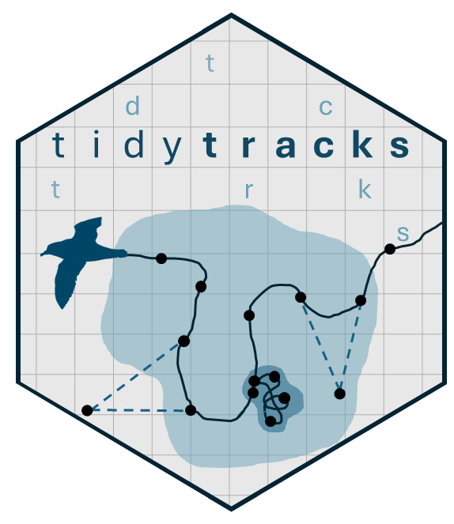

# tidytracks 

<!-- badges: start -->

[](https://codecov.io/gh/EvolEcolGroup/tidytracks)
[](https://github.com/EvolEcolGroup/tidytracks/actions/workflows/R-CMD-check.yaml)

<!-- badges: end -->
`tidytracks` is a tidyverse-friendly R package that provides a coherent and
expressive grammar for processing, analysing and visualising animal tracking data.

Movement ecology has been transformed by the availability of high-resolution
tracking data, creating demand for tools that support fast, readable and
reproducible analytical workflows.

Built on the modern [`sf`](https://r-spatial.github.io/sf/) spatial
infrastructure and leveraging the [`move2`](https://bartk.gitlab.io/move2/)
object class, `tidytracks` organises data into efficient, relational tables
that link
spatiotemporal tracks with animal- and deployment-level metadata. It
provides a consistent and expressive set of verbs for working with tracking
data, allowing complex analytical workflows to be written as a sequence
of intuitive operations.

Rather than requiring users to combine multiple packages with different
interfaces and data structures, tidytracks brings common movement-analysis
tasks into a unified framework. The package includes tools for speed
filtering, trip splitting, summary statistics, home-range estimation
and visualisation, all designed to work together through the same grammar.

By providing an expressive grammar for movement-data analysis, `tidytracks`
simplifies and standardises workflows, improves code readability and
reproducibility, and facilitates the integration of tracking analyses
within the wider tidyverse ecosystem.

## Installation

You can install the development version of tidytracks from
[GitHub](https://github.com/) with:

``` r
# install.packages("pak")
pak::pak("EvolEcolGroup/tidytracks")
```
