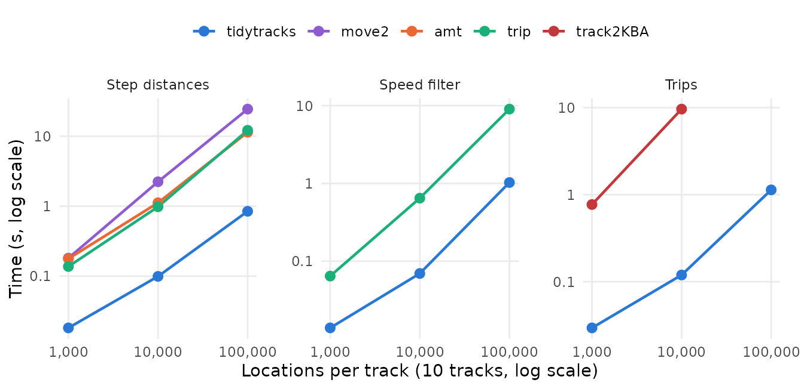
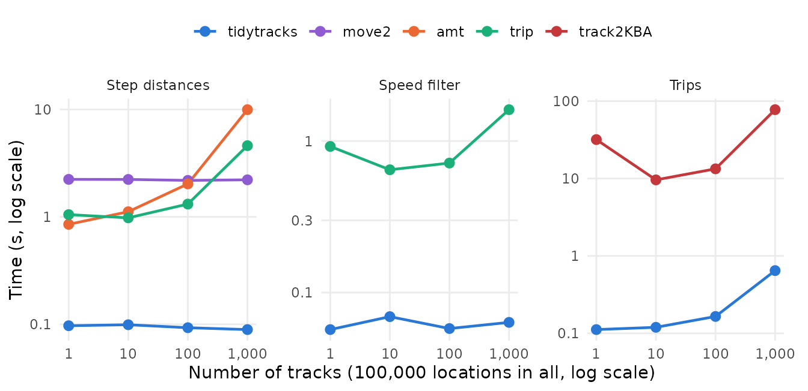

# Performance of common track operations

`tidytracks` works on `move2` objects, and many of its functions do what
other packages for tracking data also do. This article compares how long
`tidytracks` takes for three common operations with other packages that
offer them:

- the distance between consecutive locations of each track (step
  lengths), with `move2` (Kranstauber et al. 2024), `amt` (Signer et
  al. 2019) and `trip` (Sumner 2011);
- the speed filter of McConnell et al. (1992), with `trip`, from which
  `tidytracks` ported it;
- splitting the tracks of a central place forager into trips away from
  its nest, with `track2KBA` (Beal et al. 2021).

It also checks that, given the same settings, they give the same
results, and shows how the time of each operation grows with the length
and the number of the tracks.

The [results](#results) come first. The second part, [How the benchmark
was run](#how-the-benchmark-was-run), describes the simulated tracks and
the benchmark, with their code, and how to run it again.

## Results

### Summary

- Given the same settings, the packages give the same results, except at
  the ends of some tracks and trips, and up to the differences between
  geodesic distances and distances on a sphere.
- `tidytracks` is the fastest for the three operations: for the step
  distances, the other packages take 9.9 to 24 times as long, and
  `track2KBA` takes 80 to 81 times as long to split the tracks into
  trips. Its speed filter runs the same algorithm as that of `trip`,
  which takes 9.3 to 12 times as long.
- The time of `tidytracks` grows in proportion to the number of
  locations. It computes the step distances and runs the speed filter on
  all the tracks at once, so their times hardly depend on the number of
  tracks, and its trip splitting adds less than a millisecond per track
  (0.53 ms), whereas `amt` adds 8.9 ms per track to the step distances,
  and `trip` 0.97 ms to the speed filter. This overhead matters only for
  data sets with many short tracks.

The packages are compared on two data sets of simulated tracks, as in
the [home range
benchmark](https://evolecolgroup.github.io/tidytracks/dev/articles/hr_benchmark.md):
many tracks of medium length (100 tracks of 1,000 locations), and a few
long tracks (10 tracks of 10,000 locations), with the same settings in
all the packages. Two series of data sets then show how the times grow
with the length and the number of the tracks (see [The data
sets](#the-data-sets) and [Running the
operations](#running-the-operations)).

### Do the packages give the same results?

| Operation | Package | Difference from tidytracks |
|:---|:---|:---|
| Step distances | move2 | up to 0.35% (on a sphere) |
| Step distances | amt | up to 0.35% (on a sphere) |
| Step distances | trip | none (up to rounding errors) |
| Speed filter | trip | 12 of 1,429 flagged locations, in 2 tracks |
| Trips | track2KBA | only at the ends of trips (1,317 locations) and of tracks (5 trips) |

Differences between the results, over all the data sets. {.table}

- **Step distances**: `move2` and `amt` measure the steps on a sphere
  rather than on the ellipsoid (with `sf::sf_use_s2(FALSE)`, they give
  the same distances as `tidytracks`).
- **Speed filter**: the locations flagged differently are in tracks
  whose second-to-last location is an outlier. `tidytracks` then flags
  the locations before the outlier, one at a time, until the speeds to
  the outlier are low enough, whereas `trip` (in version 1.10.0) flags
  only the location just before it, as it computes the speeds between
  locations two steps apart wrongly for longitudes and latitudes.
  Neither package can flag the first two and last two locations of a
  track, whose speeds are not computed by the filter: 6 of the 1,398
  simulated outliers are among them, and other locations of the same
  tracks are flagged instead (`check_first_last = TRUE` makes
  `tidytracks` also check the first and last locations).
- **Trips**: `track2KBA` includes in each trip the first location back
  within 5 km of the nest, and, when the last location of a track is the
  first one beyond 5 km of the nest, `tidytracks` makes it a trip of its
  own (an incomplete one), whereas `track2KBA` does not.

### How long do they take?


| Data set | Operation | tidytracks | move2 | amt | trip | track2KBA |
|:---|:---|---:|---:|---:|---:|---:|
| 100 tracks of 1e+03 locations | Step distances | 0.093 | 2.2 | 2 | 1.3 |  |
| 100 tracks of 1e+03 locations | Speed filter | 0.058 |  |  | 0.72 |  |
| 100 tracks of 1e+03 locations | Trips | 0.17 |  |  |  | 13 |
| 10 tracks of 1e+04 locations | Step distances | 0.099 | 2.2 | 1.1 | 0.98 |  |
| 10 tracks of 1e+04 locations | Speed filter | 0.069 |  |  | 0.65 |  |
| 10 tracks of 1e+04 locations | Trips | 0.12 |  |  |  | 9.6 |

Time (s) of each operation on all the tracks of each data set (median of
three to ten runs). {.table style="width:100%;"}

- **Step distances**: `tidytracks` is the fastest: `move2` takes 23 to
  24 times as long, `amt` 11 to 22 times and `trip` 9.9 to 14 times.
  `tidytracks` computes the distances of all the tracks at once (with
  `geodist`), whereas `amt` and `trip` measure each track in turn.
- **Speed filter**: `tidytracks` and `trip` run the same algorithm, in
  R, but `trip` filters each track in turn, and computes the speeds
  between all the remaining locations again in each pass of the filter,
  whereas `tidytracks` filters all the tracks at once, only computes
  again the speeds around the locations removed in the previous pass,
  and only computes geodesic distances where the speeds could exceed the
  maximum (which it finds with a fast upper bound of the distances):
  `trip` takes 9.3 to 12 times as long.
- **Trips**: `track2KBA` takes 80 to 81 times as long as `tidytracks`,
  as it goes through the locations of each track one at a time, in R.

### How the times grow

#### Longer tracks



With 10 tracks, the time of the operations grows about in proportion to
the number of locations: on the 1,000,000 locations of the largest data
set, `tidytracks` takes about 0.84 µs per location for the step
distances, 1 µs for the speed filter, and 1.1 µs for the trips. The time
of `track2KBA` grows faster than the length of the tracks, as it updates
the whole track at many of its steps: with tracks ten times as long
(from 1,000 to 10,000 locations), it takes 12 times as long. It was thus
not run on the largest data set, on which it would take more than 5
minutes.

#### More tracks



With the same 100,000 locations in more and more tracks, the time of the
operations that handle each track in turn grows with the number of
tracks. `tidytracks` and `move2` compute the step distances of all the
tracks at once, so their time hardly depends on the number of tracks
(0.089 s with `tidytracks` for 1,000 tracks, against 0.097 s for a
single track), whereas `amt` and `trip` add about 8.9 ms and 3.7 ms per
track. Likewise, the speed filter of `tidytracks` runs on all the tracks
at once (0.064 s for 1,000 tracks, against 0.057 s for a single track),
whereas `trip` adds about 0.97 ms per track. Trip splitting adds about
0.53 ms per track with `tidytracks`. `track2KBA` adds the trips of each
track to those of the previous tracks with
[`rbind()`](https://rdrr.io/r/base/cbind.html), which copies them all
each time, so it takes 78 s on the 1,000 tracks.

## How the benchmark was run

The benchmark takes about 20 minutes to run, so it was run once with the
script `vignettes/articles/code/operations_benchmark.R` (in the source
code of the package), and its results are read here from
`vignettes/articles/benchmark-results.rds`. The code shown below is
taken from that script. Timings depend on the machine (see [Machine and
software](#machine-and-software)), but the differences between the
packages, and how the times grow with the size of the data, should be
similar on other machines.

The benchmark uses these packages:

``` r

library(tidytracks)
# move2, amt, trip and track2KBA are not attached: their functions are called
# with ::, to make clear which package each of them comes from
```

### Simulating tracks

The tracks are those of a central place forager, such as a seabird
breeding in a colony, with a GPS location every 5 minutes. They are
simulated, so that data sets of any size can be made with the same
properties:

``` r

# Simulate the GPS tracks of a central place forager (e.g. a seabird breeding
# in a colony), with a location every 5 minutes: each animal alternates stays
# at its nest (of 2 to 12 hours) and foraging trips (of 6 to 24 hours, to a
# distance of 10 to 80 km from the nest, out on one bearing and back on
# another). The locations have a GPS error of about 30 m, and about 1 in 1000
# of them is an outlier, 50 to 300 km away from where the animal was.
# Returns a data frame with the id, longitude, latitude and time of each
# location, whether it is an outlier, and the location of the nest of each
# animal.
simulate_tracks <- function(n_tracks, n_locations, seed) {
  set.seed(seed)
  # the colony, and the nest of each animal, within about 100 m of it
  colony_lon <- -2.56
  colony_lat <- 56.19
  km_per_degree_lat <- 111.32
  km_per_degree_lon <- km_per_degree_lat * cos(colony_lat * pi / 180)
  ids <- sprintf(paste0("bird_%0", nchar(n_tracks), "d"), seq_len(n_tracks))
  nest_lon <- colony_lon + stats::rnorm(n_tracks, 0, 0.1) / km_per_degree_lon
  nest_lat <- colony_lat + stats::rnorm(n_tracks, 0, 0.1) / km_per_degree_lat
  one_track <- function(i) {
    # bouts at the nest and trips, alternating, until the track has
    # n_locations (each pair of bouts has at least 96 locations)
    n_pairs <- ceiling(n_locations / 96) + 1
    bout_length <- as.vector(rbind(
      sample(24:144, n_pairs, replace = TRUE),
      sample(72:288, n_pairs, replace = TRUE)
    ))
    on_trip <- rep(c(FALSE, TRUE), n_pairs)
    # the track starts at a random point of the first stay at the nest
    bout_length[1] <- sample(bout_length[1], 1)
    n_bouts <- which(cumsum(bout_length) >= n_locations)[1]
    bout_length <- bout_length[seq_len(n_bouts)]
    bout <- rep(seq_len(n_bouts), bout_length)[seq_len(n_locations)]
    # how far each location is through its bout (between 0 and 1)
    progress <- sequence(bout_length)[seq_len(n_locations)] /
      (bout_length[bout] + 1)
    # distance (in km) and bearing from the nest
    max_distance <- stats::runif(n_bouts, 10, 80)[bout]
    distance <- ifelse(on_trip[bout], max_distance * sin(pi * progress), 0)
    bearing <- stats::runif(n_bouts, 0, 2 * pi)[bout] +
      0.6 * sin(2 * pi * progress)
    # positions (in km from the nest), with the GPS error
    x <- distance * sin(bearing) + stats::rnorm(n_locations, 0, 0.03)
    y <- distance * cos(bearing) + stats::rnorm(n_locations, 0, 0.03)
    # outliers
    outlier <- which(stats::runif(n_locations) < 0.001)
    jump <- stats::runif(length(outlier), 50, 300)
    jump_bearing <- stats::runif(length(outlier), 0, 2 * pi)
    x[outlier] <- x[outlier] + jump * sin(jump_bearing)
    y[outlier] <- y[outlier] + jump * cos(jump_bearing)
    # a location every 5 minutes (give or take a few seconds), from a random
    # time on the first day of tracking
    time <- stats::runif(1, 0, 86400) +
      cumsum(c(0, 300 + sample(-5:5, n_locations - 1, replace = TRUE)))
    list(
      lon = nest_lon[i] + x / km_per_degree_lon,
      lat = nest_lat[i] + y / km_per_degree_lat,
      time = time,
      outlier = seq_len(n_locations) %in% outlier
    )
  }
  tracks <- lapply(seq_len(n_tracks), one_track)
  data.frame(
    id = rep(ids, each = n_locations),
    lon = unlist(lapply(tracks, `[[`, "lon")),
    lat = unlist(lapply(tracks, `[[`, "lat")),
    time = as.POSIXct("2024-06-01", tz = "UTC") +
      round(unlist(lapply(tracks, `[[`, "time"))),
    outlier = unlist(lapply(tracks, `[[`, "outlier")),
    nest_lon = rep(nest_lon, each = n_locations),
    nest_lat = rep(nest_lat, each = n_locations)
  )
}
```

For example, the first two days of three tracks (the black points are
the nests, and the lines that leave the map go to outliers):

``` r

example_tracks <- simulate_tracks(n_tracks = 3, n_locations = 576, seed = 1)
ggplot(example_tracks, aes(lon, lat)) +
  geom_path(colour = "grey40", linewidth = 0.3) +
  geom_point(
    aes(nest_lon, nest_lat),
    data = distinct(example_tracks, id, nest_lon, nest_lat),
    colour = "black",
    size = 2
  ) +
  facet_wrap(~id) +
  coord_quickmap(
    xlim = mean(example_tracks$nest_lon) + c(-1.4, 1.4),
    ylim = mean(example_tracks$nest_lat) + c(-0.8, 0.8)
  ) +
  labs(x = "Longitude", y = "Latitude") +
  theme_minimal() +
  theme(panel.grid.minor = element_blank())
```


### The data sets

The time taken by an operation on a set of tracks has two parts: one
that grows with the number of locations, and an overhead for each track
(e.g. to select its locations, or to build its results). The benchmark
uses two series of data sets: tracks of increasing length (with the same
number of tracks), and the same total number of locations split into an
increasing number of tracks (from a single long track to many short
ones):

``` r

# Two series of data sets, to separate the cost of each location from the
# cost of each track: 10 tracks of increasing length, and 100,000 locations
# in all, split into an increasing number of tracks (10 tracks of 10,000
# locations are in both series)
series_tracks <- 10
track_lengths <- c(1000, 10000, 100000)
series_total <- 1e5
track_counts <- c(1, 10, 100, 1000)
```

``` r

data_sets <- unique(rbind(
  data.frame(tracks = series_tracks, locations = track_lengths),
  data.frame(tracks = track_counts, locations = series_total / track_counts)
))
```

Two of these data sets, many tracks of medium length and a few long
tracks, are those on which the packages are compared:

| Tracks | Locations per track | Days per track | Total locations | Comparison | Series |
|---:|---:|---:|---:|:---|:---|
| 10 | 1,000 | 3.5 | 10,000 |  | longer tracks |
| 10 | 10,000 | 35 | 100,000 | long tracks | both |
| 10 | 100,000 | 350 | 1,000,000 |  | longer tracks |
| 1 | 100,000 | 350 | 100,000 |  | more tracks |
| 100 | 1,000 | 3.5 | 100,000 | medium tracks | more tracks |
| 1,000 | 100 | 0.35 | 100,000 |  | more tracks |

### Running the operations

Each package works on its own class of objects: a `move2` object for
`tidytracks` and `move2`, a `track_xyt` for `amt`, a `trip` object (a
`SpatialPointsDataFrame` from `sp`) for `trip`, and data frames for
`track2KBA`. These are built from the data frame of locations of each
data set (outside of the timings):

``` r

# the input of each package, built from a data frame of locations; tidytracks
# works on move2 objects, so the same object is used for both packages
make_inputs <- function(df) {
  move <- move2::mt_as_move2(
    df,
    coords = c("lon", "lat"),
    crs = 4326,
    time_column = "time",
    track_id_column = "id",
    track_attributes = c("nest_lon", "nest_lat")
  )
  # the nests, as a column of points in the metadata
  show_meta(move) <- show_meta(move) |>
    # nolint next: object_usage_linter.
    dplyr::mutate(nest = sf_point_col(nest_lon, nest_lat, crs = 4326))
  # trip objects are SpatialPointsDataFrames (from sp)
  trip_df <- df[, c("lon", "lat", "time", "id")]
  sp::coordinates(trip_df) <- c("lon", "lat")
  sp::proj4string(trip_df) <- sp::CRS("EPSG:4326")
  # the first location of each track, for its nest
  first <- !duplicated(df$id)
  list(
    tidytracks = move,
    move2 = move,
    # nolint next: object_usage_linter.
    amt = amt::make_track(df, lon, lat, time, id = id, crs = 4326),
    trip = trip::trip(trip_df, c("time", "id")),
    track2KBA = list(
      data = data.frame(
        ID = df$id,
        Latitude = df$lat,
        Longitude = df$lon,
        DateTime = df$time
      ),
      colony = data.frame(
        ID = df$id[first],
        Latitude = df$nest_lat[first],
        Longitude = df$nest_lon[first]
      )
    )
  )
}
```

The operations are then run with each package, on all the tracks of a
data set:

``` r

# The operations timed, with the function of each package, which takes the
# input of its package (all the tracks)
operations <- list(
  # the distance from each location to the next one of the same track (in
  # km); amt measures the steps of a single track, so it is applied to each
  # track in turn, after nesting the tracks as shown in its documentation
  distance = list(
    tidytracks = function(input) {
      event_distance(input, units = as_units("km"))
    },
    move2 = function(input) {
      move2::mt_distance(input, units = "km")
    },
    amt = function(input) {
      input |>
        tidyr::nest(data = -id) |>
        dplyr::mutate(
          steps = purrr::map(data, amt::step_lengths, lonlat = TRUE)
        )
    },
    trip = function(input) {
      trip::trackDistance(input, prev = TRUE)
    }
  ),
  # the McConnell speed filter, with a maximum speed of 120 km/h
  speed_filter = list(
    tidytracks = function(input) {
      event_flag_mcconnell(input, max_speed = as_units(120, "km/h"))
    },
    trip = function(input) {
      trip::speedfilter(input, max.speed = 120)
    }
  ),
  # trips beyond 5 km of the nest, keeping the locations at the nest
  trip_split = list(
    tidytracks = function(input) {
      tt_split_trips(
        input,
        centre_col = "nest",
        buffer_outbound = as_units(5, "km"),
        buffer_inbound = as_units(5, "km"),
        complete = FALSE
      )
    },
    track2KBA = function(input) {
      track2KBA::tripSplit(
        input$data,
        colony = input$colony,
        innerBuff = 5,
        returnBuff = 5,
        duration = 0,
        nests = TRUE,
        rmNonTrip = FALSE,
        verbose = FALSE
      )
    }
  )
)
```

The settings are matched so that the packages give the same results:

- **Step distances**: `tidytracks` and `trip` compute geodesic distances
  on the WGS84 ellipsoid (with the `geodist` package), whereas `move2`
  and `amt` use
  [`sf::st_distance()`](https://r-spatial.github.io/sf/reference/geos_measures.html),
  which, with `s2` (the default of `sf`), computes great circle
  distances on a sphere. `tidytracks`, `move2` and `amt` give `NA` for
  the last location of each track, and `trip` gives 0. `amt` measures
  the steps of a single track, so its tracks are nested and measured in
  turn, as in its documentation, and this is included in its time.
- **Speed filter**: `tidytracks` and `trip` run the same algorithm, with
  a maximum speed of 120 km/h (`trip` takes it in km/h, for longitudes
  and latitudes). The optional check of the first and last locations of
  each track of `tidytracks` is off by default.
- **Trips**: both packages use the nest of each animal, start a trip
  when the animal goes further than 5 km from it, end it when it comes
  back within 5 km, and keep the locations at the nest. `track2KBA`
  drops trips shorter than a minimum duration, which is set to 0 here,
  as `tidytracks` has none.

Each operation is run once, as a warm-up, which also gives the results
compared, and then, if that took less than a minute, again until these
runs have taken a minute (but at least three and at most ten times), of
which the median time is reported:

``` r

# Time an operation: a first run (as a warm-up, which also gives its result),
# then, if it took less than a minute, more runs, until they have taken a
# minute (but at least 3 and at most 10 runs), whose median time is reported.
time_operation <- function(operation, input) {
  # free the memory used by the previous operations
  gc()
  start <- bench::hires_time()
  result <- operation(input)
  seconds <- as.numeric(bench::hires_time() - start)
  runs <- 1
  if (seconds < 60) {
    timing <- bench::mark(
      operation(input),
      min_time = 60,
      min_iterations = 3,
      max_iterations = 10,
      check = FALSE,
      memory = FALSE,
      filter_gc = FALSE
    )
    seconds <- as.numeric(timing$median)
    runs <- timing$n_itr
  }
  list(result = result, seconds = seconds, runs = runs)
}
```

``` r

timings <- list()
check_results <- list()
for (i in seq_len(nrow(data_sets))) {
  n_tracks <- data_sets$tracks[i]
  n_locations <- data_sets$locations[i]
  df <- simulate_tracks(n_tracks, n_locations, seed = i)
  inputs <- make_inputs(df)
  for (operation in names(operations)) {
    results <- list()
    for (package in names(operations[[operation]])) {
      # track2KBA is not run on the largest data set (the 10 longest tracks):
      # its time grows faster than the length of the tracks, and it would
      # take more than 5 minutes (see its time on a single long track)
      if (package == "track2KBA" && n_tracks * n_locations > series_total) {
        next
      }
      message(
        "Timing ", operation, " with ", package, " on ", n_tracks,
        " tracks of ", n_locations, " locations"
      )
      timed <- time_operation(
        operations[[operation]][[package]],
        inputs[[package]]
      )
      results[[package]] <- timed$result
      timings[[length(timings) + 1]] <- data.frame(
        tracks = n_tracks,
        locations = n_locations,
        operation = operation,
        package = package,
        seconds = timed$seconds,
        runs = timed$runs
      )
    }
    # compare the results, if all the packages were run
    if (all(names(operations[[operation]]) %in% names(results))) {
      check_results[[length(check_results) + 1]] <- data.frame(
        tracks = n_tracks,
        locations = n_locations,
        operation = operation,
        checks[[operation]](results, df)
      )
    }
  }
}
timings <- do.call(rbind, timings)
check_results <- do.call(rbind, check_results)
```

The results of each package are then compared with those of
`tidytracks`, on each data set:

``` r

# Compare the results of each package with those of tidytracks, for the
# data frame of locations `df`, which is ordered by track and time. Returns a
# data frame of checks: the largest relative difference between the step
# distances, the number of locations flagged differently by the speed
# filter, and the number of trips found by each package and of locations in
# them (and why they differ).
compare_distance <- function(results, df) {
  # in km, with NA for the last location of each track
  tidytracks <- as.numeric(results$tidytracks)
  last <- is.na(tidytracks)
  others <- list(
    move2 = as.numeric(results$move2),
    # amt::make_track() orders the locations by time, whatever their track,
    # so its tracks are nested in the order in which they start
    amt = unlist(
      results$amt$steps[match(unique(df$id), results$amt$id)]
    ) / 1000,
    trip = results$trip
  )
  data.frame(
    package = names(others),
    check = "largest relative difference in step distance",
    value = vapply(others, function(d) {
      stopifnot(length(d) == length(tidytracks))
      max(abs(d[!last] / tidytracks[!last] - 1), na.rm = TRUE)
    }, numeric(1))
  )
}
compare_speed_filter <- function(results, df) {
  flagged <- !results$tidytracks
  differ <- results$tidytracks != results$trip
  tracks_differ <- unique(df$id[differ])
  # the first two and last two locations of each track, which the filter
  # cannot flag
  n <- nrow(df)
  first <- c(TRUE, df$id[-1] != df$id[-n])
  last <- c(df$id[-1] != df$id[-n], TRUE)
  second <- c(FALSE, first[-n])
  second_to_last <- c(last[-1], FALSE)
  ends <- first | second | second_to_last | last
  # the tracks whose second-to-last location is an outlier
  outlier_second_to_last <- unique(df$id[second_to_last & df$outlier])
  data.frame(
    package = c(
      "both", "both", "tidytracks", "tidytracks", "trip", "trip", "trip"
    ),
    check = c(
      "outliers",
      "outliers among the first two or last two locations of a track",
      "locations flagged",
      "outliers flagged",
      "locations flagged differently",
      "tracks with locations flagged differently",
      "tracks with an outlier second to last, flagged differently"
    ),
    value = c(
      sum(df$outlier),
      sum(df$outlier & ends),
      sum(flagged),
      sum(flagged & df$outlier),
      sum(differ),
      length(tracks_differ),
      length(intersect(tracks_differ, outlier_second_to_last))
    )
  )
}
compare_trip_split <- function(results, df) {
  # tidytracks: the locations at the nest are in the dummy trips *_trip_na
  tt_trip <- results$tidytracks$trip_id
  tt_in_trip <- !grepl("_trip_na$", tt_trip)
  # track2KBA: the locations at the nest are in the trip "-1" (its results
  # are ordered by track and time, as df)
  stopifnot(identical(as.character(results$track2KBA$ID), df$id))
  kba_trip <- results$track2KBA$tripID
  kba_in_trip <- kba_trip != "-1"
  # track2KBA also includes in each trip the first location back within the
  # buffer, i.e. the location after the last one of a trip of tidytracks
  n <- nrow(df)
  after_trip <- c(FALSE, tt_in_trip[-n] & df$id[-1] == df$id[-n])
  return_to_nest <- !tt_in_trip & kba_in_trip & after_trip
  # tidytracks starts a trip at the last location of a track if it is the
  # first one beyond the buffer, but track2KBA does not
  last <- c(df$id[-1] != df$id[-n], TRUE)
  trip_at_end <- tt_in_trip & !kba_in_trip & last & !after_trip
  data.frame(
    package = c(
      "tidytracks", "track2KBA", "tidytracks", "track2KBA", "track2KBA",
      "tidytracks", "both"
    ),
    check = c(
      "trips", "trips", "locations in trips", "locations in trips",
      "returns to the nest in a trip",
      "trips of the last location of a track",
      "other locations in a trip in only one package"
    ),
    value = c(
      length(unique(tt_trip[tt_in_trip])),
      length(unique(kba_trip[kba_in_trip])),
      sum(tt_in_trip),
      sum(kba_in_trip),
      sum(return_to_nest),
      sum(trip_at_end),
      sum(tt_in_trip != kba_in_trip & !return_to_nest & !trip_at_end)
    )
  )
}
checks <- list(
  distance = compare_distance,
  speed_filter = compare_speed_filter,
  trip_split = compare_trip_split
)
```

### From the results to the tables and plots

The benchmark saves its results in `benchmark-results.rds`, which is
read and summarised for the [results](#results) above with this code:

``` r

# to summarise and plot the results
library(dplyr)
library(tidyr)
library(ggplot2)
series_tracks <- benchmark$series$tracks
series_total <- benchmark$series$total
# the two data sets on which the packages are compared: a few long tracks
# (the data set in both series), and ten times as many tracks of medium
# length (with the same number of locations in all)
long <- c(tracks = series_tracks, locations = series_total / series_tracks)
medium <- c(
  tracks = 10 * series_tracks,
  locations = series_total / (10 * series_tracks)
)
operation_labels <- c(
  distance = "Step distances",
  speed_filter = "Speed filter",
  trip_split = "Trips"
)
package_levels <- c("tidytracks", "move2", "amt", "trip", "track2KBA")
timings <- benchmark$timings %>%
  mutate(
    total = tracks * locations,
    data_set = paste(
      format(tracks, big.mark = ",", trim = TRUE), "tracks of",
      format(locations, big.mark = ",", trim = TRUE), "locations"
    ),
    operation = factor(operation_labels[operation], operation_labels),
    package = factor(package, package_levels)
  )
# the two data sets on which the packages are compared
compared <- timings %>%
  filter(
    (tracks == medium[["tracks"]] & locations == medium[["locations"]]) |
      (tracks == long[["tracks"]] & locations == long[["locations"]])
  ) %>%
  arrange(desc(tracks)) %>%
  mutate(data_set = factor(data_set, unique(data_set)))
# the two series: tracks of increasing length, and the same total number of
# locations in more and more tracks
longer_tracks <- timings %>%
  filter(tracks == series_tracks)
more_tracks <- timings %>%
  filter(total == series_total)
```

and the plots of the timings are drawn with:

``` r

# one colour per package
package_colours <- c(
  tidytracks = "#2a78d6",
  move2 = "#8e5bd0",
  amt = "#eb6834",
  trip = "#1baf7a",
  track2KBA = "#c4373b"
)
# the times of a series of data sets, with one panel per operation
series_plot <- function(data, x, x_label) {
  # nolint next: object_usage_linter.
  ggplot(data, aes(x = {{ x }}, y = seconds, colour = package)) +
    geom_line(linewidth = 0.8) +
    geom_point(size = 2.5) +
    facet_wrap(~operation, nrow = 1, scales = "free_y") +
    scale_x_log10(labels = scales::label_comma()) +
    scale_y_log10(labels = scales::label_number(drop0trailing = TRUE)) +
    scale_colour_manual(values = package_colours) +
    labs(x = x_label, y = "Time (s, log scale)", colour = NULL) +
    theme_minimal() +
    theme(
      panel.grid.minor = element_blank(),
      panel.spacing.x = unit(1.5, "lines"),
      # room for the last label of the x axis
      plot.margin = margin(5.5, 15, 5.5, 5.5),
      legend.position = "top"
    )
}
ggplot(compared, aes(x = seconds, y = package, colour = package)) +
  geom_point(size = 3) +
  # each operation with its own packages
  facet_grid(operation ~ data_set, scales = "free_y", space = "free_y") +
  scale_x_log10(labels = scales::label_number(drop0trailing = TRUE)) +
  scale_y_discrete(limits = rev) +
  scale_colour_manual(values = package_colours, guide = "none") +
  labs(x = "Time (s, log scale)", y = NULL) +
  theme_minimal() +
  theme(
    panel.grid.minor = element_blank(),
    panel.grid.major.y = element_blank(),
    panel.spacing.x = unit(2, "lines"),
    strip.text.y = element_text(angle = 0, hjust = 0),
    panel.border = element_rect(
      colour = "grey70",
      fill = NA,
      linewidth = 0.5
    )
  )
series_plot(
  longer_tracks,
  locations,
  paste0(
    "Locations per track (", series_tracks, " tracks, log scale)"
  )
)
series_plot(
  more_tracks,
  tracks,
  paste0(
    "Number of tracks (", fmt(series_total), " locations in all, log scale)"
  )
)
```

### Running the benchmark again

To run the benchmark again (e.g. after changing `tidytracks`, or on
another machine), install `tidytracks` (with `R CMD INSTALL`, rather
than loading it with `devtools::load_all()`, which compiles its C++ code
without optimisation) and the other packages, and run, on an otherwise
idle machine:

``` sh
cd vignettes/articles
Rscript code/operations_benchmark.R
```

which overwrites `benchmark-results.rds`; then render this article
again. `Rscript code/operations_benchmark.R quick` runs everything on a
few small data sets in less than a minute, to check the script, and
saves its results in a temporary directory instead.

### Machine and software

|            |                                           |
|:-----------|:------------------------------------------|
| date       | 2026-10-29                                |
| R          | R version 4.6.1 (2026-06-24)              |
| platform   | x86_64-pc-linux-gnu                       |
| CPU        | Intel(R) Core(TM) i7-10510U CPU @ 1.80GHz |
| cores      | 4                                         |
| BLAS       | libblas.so.3                              |
| tidytracks | 0.2.1.9004                                |
| move2      | 0.5.0                                     |
| amt        | 0.3.1.0                                   |
| trip       | 1.10.0                                    |
| track2KBA  | 1.1.3                                     |
| sf         | 1.1.3                                     |
| sp         | 2.2.4                                     |
| s2         | 1.1.13                                    |
| geodist    | 0.1.1                                     |
| units      | 1.0.1                                     |
| bench      | 1.1.4                                     |

## References

Beal, M., Oppel, S., Pearmain, E. J., Morera-Pujol, V., Carneiro, A. P.
B., Davies, T. E., Phillips, R. A., Taylor, P. R., Miller, M. G. R.,
Franco, A. M. A., Catry, I., Patrício, A. R., Regalla, A., Staniland,
I., Boyd, C., Catry, P. & Dias, M. P. (2021). track2KBA: an R package
for identifying important sites for biodiversity from tracking data.
*Methods in Ecology and Evolution*, 12, 2372-2378.
<https://doi.org/10.1111/2041-210X.13713>

Kranstauber, B., Safi, K. & Scharf, A. K. (2024). move2: R package for
processing movement data. *Methods in Ecology and Evolution*.
<https://doi.org/10.1111/2041-210X.14383>

McConnell, B. J., Chambers, C. & Fedak, M. A. (1992). Foraging ecology
of southern elephant seals in relation to the bathymetry and
productivity of the Southern Ocean. *Antarctic Science*, 4, 393-398.

Signer, J., Fieberg, J. & Avgar, T. (2019). Animal movement tools (amt):
R package for managing tracking data and conducting habitat selection
analyses. *Ecology and Evolution*, 9, 880-890.

Sumner, M. D. (2011). *The tag location problem*. PhD thesis, University
of Tasmania (which describes the `trip` package).
