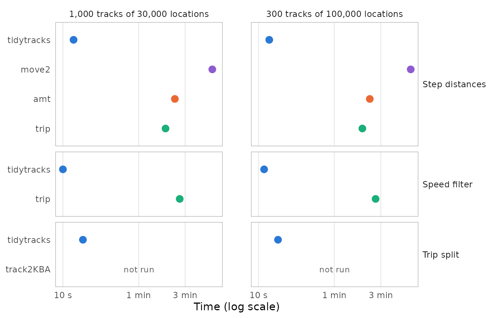
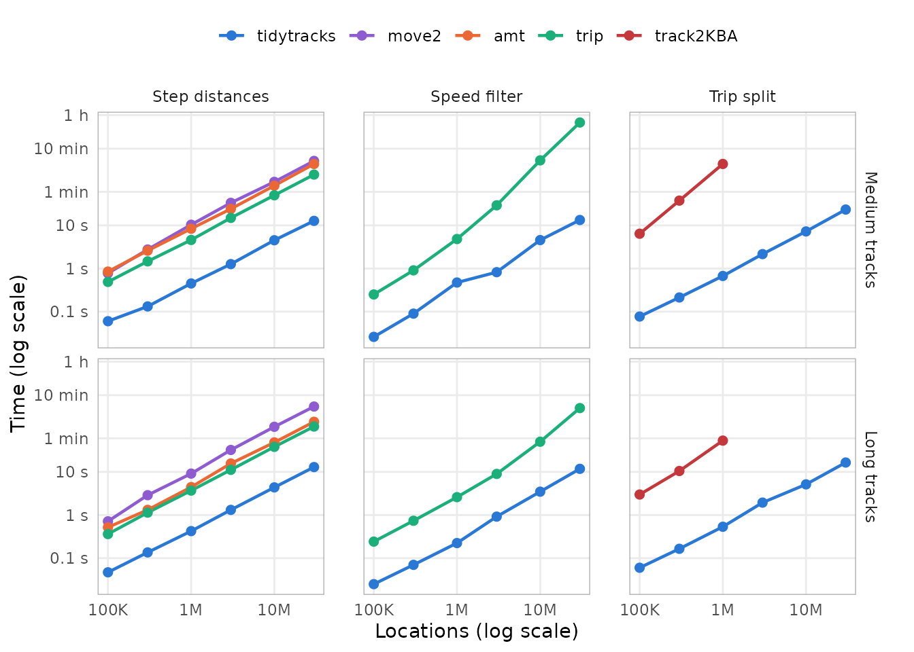
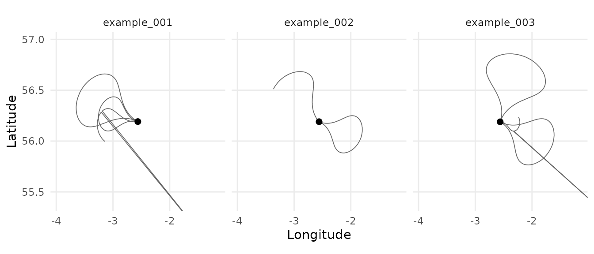

# Benchmark of common track operations

`tidytracks` works on `move2` objects, and many of its functions do what
other packages for tracking data also do. This article compares how long
`tidytracks` takes for three common operations with other packages that
offer them:

- the distance between consecutive locations of each track (step
  lengths), with `move2` (Kranstauber et al. 2024), `amt` (Signer et
  al. 2019) and `trip` (Sumner 2011);
- the speed filter of McConnell et al. (1992), with `trip`, from which
  `tidytracks` ported it;
- splitting the tracks of a central place forager into trips away from
  its nest, with `track2KBA` (Beal et al. 2021).

It also checks that, given the same settings, they give the same
results, and shows how the time of each operation grows with the size of
the data, up to tens of millions of locations.

The [results](#results) come first. The second part, [How the benchmark
was run](#how-the-benchmark-was-run), describes the simulated tracks and
the benchmark, with their code, and how to run it again.

## Results

### Summary

- Given the same settings, the packages give the same results, except at
  the ends of some tracks and trips, and up to the differences between
  geodesic distances and distances on a sphere.
- `tidytracks` is the fastest for the three operations. On 30,000,000
  locations, in 1,000 tracks of 30,000 locations or 300 tracks of
  100,000 locations, it computes the step distances in 13 s, whereas the
  other packages take 8.8 to 28 times as long (up to 6.1 min with
  `move2`). Its speed filter runs the same algorithm as that of `trip`,
  which takes 14 to 16 times as long, and more on more tracks (40 min
  for 30,000 tracks of 1,000 locations, against 13 s). `track2KBA` takes
  99 to 400 times as long to split the tracks into trips, on 1,000,000
  locations (4.4 min for 1,000 tracks, against 0.67 s for `tidytracks`),
  and would take more than 26 min on 30,000,000 locations.
- The time of `tidytracks` grows in proportion to the number of
  locations, and hardly depends on the number of tracks: it handles all
  the tracks at once, and adds less than a millisecond per track,
  whereas `amt` adds 4.4 ms per track to the step distances. The speed
  filter of `trip` and `track2KBA` select the locations of each track
  from all the locations, so their times grow with the square of the
  number of tracks.

The packages are run with the same settings on copies of four sets of
simulated tracks (see [The data sets](#the-data-sets) and [Running the
operations](#running-the-operations)). They are compared on 30,000,000
locations in long tracks: copies of tracks of a season and of a year,
i.e. 1,000 tracks of 30,000 locations, and 300 tracks of 100,000
locations. To show how the times grow with the size of the data, the
data sets of medium tracks (of 1,000 locations) and of long tracks (of
10,000 locations) grow from a single copy of the simulated tracks (100
and 10 tracks) to 300 copies (30,000,000 locations).

### Do the packages give the same results?

| Operation | Package | Difference from tidytracks |
|:---|:---|:---|
| Step distances | move2 | up to 0.35% (on a sphere) |
| Step distances | amt | up to 0.35% (on a sphere) |
| Step distances | trip | none (up to rounding errors) |
| Speed filter | trip | none (of the 201 flagged locations) |
| Trip split | track2KBA | only at the ends of trips (798 locations) and of tracks (1 trip) |

Differences between the results, on the simulated medium and long tracks
(their copies give the same results). {.table}

- **Step distances**: `move2` and `amt` measure the steps on a sphere
  rather than on the ellipsoid (with `sf::sf_use_s2(FALSE)`, they give
  the same distances as `tidytracks`).
- **Speed filter**: the two packages flag the same locations, except in
  tracks whose second-to-last location is an outlier (no tracks here).
  `tidytracks` then flags the locations before the outlier, one at a
  time, until the speeds to the outlier are low enough, whereas `trip`
  (in version 1.10.0) flags only the location just before it, as it
  computes the speeds between locations two steps apart wrongly for
  longitudes and latitudes. Neither package can flag the first two and
  last two locations of a track, whose speeds are not computed by the
  filter, and an outlier among them can make them flag other locations
  of the same track instead (none of the 201 simulated outliers are
  among them; `check_first_last = TRUE` makes `tidytracks` also check
  the first and last locations).
- **Trip split**: `track2KBA` includes in each trip the first location
  back within 5 km of the nest, and, when the last location of a track
  is the first one beyond 5 km of the nest, `tidytracks` makes it a trip
  of its own (an incomplete one), whereas `track2KBA` does not.

### How long do they take?

On 30,000,000 locations in long tracks (copies of the tracks of a season
and of a year):



| Data set | Operation | tidytracks | move2 | amt | trip | track2KBA |
|:---|:---|---:|---:|---:|---:|---:|
| 1,000 tracks of 30,000 locations | Step distances | 13 s | 5.7 min | 2.4 min | 1.9 min |  |
| 1,000 tracks of 30,000 locations | Speed filter | 10 s |  |  | 2.6 min |  |
| 1,000 tracks of 30,000 locations | Trip split | 16 s |  |  |  | not run |
| 300 tracks of 100,000 locations | Step distances | 13 s | 6.1 min | 2.3 min | 1.9 min |  |
| 300 tracks of 100,000 locations | Speed filter | 11 s |  |  | 2.7 min |  |
| 300 tracks of 100,000 locations | Trip split | 16 s |  |  |  | not run |

Time of each operation on all the tracks of the data sets of copies of
the tracks of a season and of a year. {.table}

- **Step distances**: `tidytracks` is the fastest: `move2` takes 27 to
  28 times as long, `amt` 11 times and `trip` 8.8 to 9 times.
  `tidytracks` computes the distances of all the tracks at once (with
  `geodist`), whereas `amt` and `trip` measure each track in turn.
- **Speed filter**: `tidytracks` and `trip` run the same algorithm, in
  R, but `trip` filters each track in turn (selecting its locations from
  all the locations), and computes the speeds between all the remaining
  locations again in each pass of the filter, whereas `tidytracks`
  filters all the tracks at once, only computes again the speeds around
  the locations removed in the previous pass, and only computes geodesic
  distances where the speeds could exceed the maximum (which it finds
  with a fast upper bound of the distances): `trip` takes 14 to 16 times
  as long. Its time also grows with the square of the number of tracks
  (see [How the times grow](#how-the-times-grow)): on the same number of
  locations in 30,000 medium tracks, it takes 40 min, against 13 s for
  `tidytracks`.
- **Trip split**: `track2KBA` was not run on these data sets, as it
  would take more than 26 min on them (30 times its time on the
  1,000,000 locations of 100 long tracks, if its time only grew in
  proportion to the number of locations, whereas it also grows with the
  number of tracks). On 10 copies of the medium and long tracks, it
  takes 99 to 400 times as long as `tidytracks` (4.4 min on the 1,000
  medium tracks, and 53 s on the 100 long tracks), as it goes through
  the locations of each track one at a time, in R (see below).

### How the times grow



The data sets grow by copying the tracks, from 100 medium tracks or 10
long tracks (100,000 locations) to 30,000 medium tracks or 3,000 long
tracks (30,000,000 locations). The times of `tidytracks`, `move2` and
`amt`, and the step distances of `trip`, grow about in proportion to the
number of locations: on the most copies of the medium tracks,
`tidytracks` takes about 0.42 µs per location for the step distances,
0.44 µs for the speed filter, and 0.78 µs for the trips, against 10 µs
for the step distances of `move2`.

The medium and long tracks have the same number of locations, but the
medium tracks are 10 times as many, so the difference between their
times gives the overhead of each track (e.g. to select its locations, or
to build its results). `tidytracks` and `move2` compute the step
distances of all the tracks at once, so their times hardly depend on the
number of tracks (13 s with `tidytracks` for 30,000 tracks, against 13 s
for 3,000 tracks), whereas `amt` and `trip` add about 4.4 ms and 1.4 ms
per track. Likewise, the speed filter of `tidytracks` runs on all the
tracks at once (13 s for 30,000 tracks, against 12 s for 3,000 tracks).

The speed filter of `trip` and `track2KBA` select the locations of each
track from all the locations, which takes longer the more locations
there are, so the overhead of each track grows with the size of the
data: `trip` adds about 7.5 ms per track to the speed filter on 30
copies of the tracks, and 79 ms on 300 copies. Their times thus grow
with the square of the number of tracks: ten times as many copies of the
medium tracks take `trip` 83 times as long to filter them (from 3,000 to
30,000 tracks), and `track2KBA` 41 times as long to split them into
trips (from 100 to 1,000 tracks), as it also adds the trips of each
track to those of the previous tracks with
[`rbind()`](https://rdrr.io/r/base/cbind.html), which copies them all
each time.

## How the benchmark was run

The benchmark takes about 140 minutes to run, so it was run once with
the script `vignettes/articles/code/operations_benchmark.R` (in the
source code of the package), and its results are read here from the
directory `vignettes/articles/data`. It uses tracks simulated beforehand
with the script `vignettes/articles/code/operations_benchmark_tracks.R`,
and stored in the same directory, so it can be run again (e.g. on
another machine) without simulating them. The code shown below is taken
from these two scripts. Timings depend on the machine (see [Machine and
software](#machine-and-software)), but the differences between the
packages, and how the times grow with the size of the data, should be
similar on other machines.

The benchmark uses these packages:

``` r

library(tidytracks)
# move2, amt, trip and track2KBA are not attached: their functions are called
# with ::, to make clear which package each of them comes from
```

### Simulating tracks

The tracks are those of a central place forager, such as a seabird
breeding in a colony, with a GPS location every 5 minutes:

``` r

# Simulate the GPS tracks of a central place forager (e.g. a seabird breeding
# in a colony), with a location every 5 minutes: each animal alternates stays
# at its nest (of 2 to 12 hours) and foraging trips (of 6 to 24 hours, to a
# distance of 10 to 80 km from the nest, out on one bearing and back on
# another). The locations have a GPS error of about 30 m, and about 1 in 1000
# of them is an outlier, 50 to 300 km away from where the animal was.
# Returns a data frame with the id, longitude, latitude and time of each
# location, whether it is an outlier, and the location of the nest of each
# animal.
simulate_tracks <- function(name, n_tracks, n_locations, seed) {
  set.seed(seed)
  # the colony, and the nest of each animal, within about 100 m of it
  colony_lon <- -2.56
  colony_lat <- 56.19
  km_per_degree_lat <- 111.32
  km_per_degree_lon <- km_per_degree_lat * cos(colony_lat * pi / 180)
  ids <- sprintf("%s_%03d", name, seq_len(n_tracks))
  nest_lon <- colony_lon + stats::rnorm(n_tracks, 0, 0.1) / km_per_degree_lon
  nest_lat <- colony_lat + stats::rnorm(n_tracks, 0, 0.1) / km_per_degree_lat
  one_track <- function(i) {
    # bouts at the nest and trips, alternating, until the track has
    # n_locations (each pair of bouts has at least 96 locations)
    n_pairs <- ceiling(n_locations / 96) + 1
    bout_length <- as.vector(rbind(
      sample(24:144, n_pairs, replace = TRUE),
      sample(72:288, n_pairs, replace = TRUE)
    ))
    on_trip <- rep(c(FALSE, TRUE), n_pairs)
    # the track starts at a random point of the first stay at the nest
    bout_length[1] <- sample(bout_length[1], 1)
    n_bouts <- which(cumsum(bout_length) >= n_locations)[1]
    bout_length <- bout_length[seq_len(n_bouts)]
    bout <- rep(seq_len(n_bouts), bout_length)[seq_len(n_locations)]
    # how far each location is through its bout (between 0 and 1)
    progress <- sequence(bout_length)[seq_len(n_locations)] /
      (bout_length[bout] + 1)
    # distance (in km) and bearing from the nest
    max_distance <- stats::runif(n_bouts, 10, 80)[bout]
    distance <- ifelse(on_trip[bout], max_distance * sin(pi * progress), 0)
    bearing <- stats::runif(n_bouts, 0, 2 * pi)[bout] +
      0.6 * sin(2 * pi * progress)
    # positions (in km from the nest), with the GPS error
    x <- distance * sin(bearing) + stats::rnorm(n_locations, 0, 0.03)
    y <- distance * cos(bearing) + stats::rnorm(n_locations, 0, 0.03)
    # outliers
    outlier <- which(stats::runif(n_locations) < 0.001)
    jump <- stats::runif(length(outlier), 50, 300)
    jump_bearing <- stats::runif(length(outlier), 0, 2 * pi)
    x[outlier] <- x[outlier] + jump * sin(jump_bearing)
    y[outlier] <- y[outlier] + jump * cos(jump_bearing)
    # a location every 5 minutes (give or take a few seconds), from a random
    # time on the first day of tracking
    time <- stats::runif(1, 0, 86400) +
      cumsum(c(0, 300 + sample(-5:5, n_locations - 1, replace = TRUE)))
    list(
      lon = nest_lon[i] + x / km_per_degree_lon,
      lat = nest_lat[i] + y / km_per_degree_lat,
      time = time,
      outlier = seq_len(n_locations) %in% outlier
    )
  }
  tracks <- lapply(seq_len(n_tracks), one_track)
  data.frame(
    id = rep(ids, each = n_locations),
    lon = unlist(lapply(tracks, `[[`, "lon")),
    lat = unlist(lapply(tracks, `[[`, "lat")),
    time = as.POSIXct("2024-06-01", tz = "UTC") +
      round(unlist(lapply(tracks, `[[`, "time"))),
    outlier = unlist(lapply(tracks, `[[`, "outlier")),
    nest_lon = rep(nest_lon, each = n_locations),
    nest_lat = rep(nest_lat, each = n_locations)
  )
}
```

For example, the first two days of three tracks (the black points are
the nests, and the lines that leave the map go to outliers):

``` r

example_tracks <- simulate_tracks(
  "example",
  n_tracks = 3,
  n_locations = 576,
  seed = 1
)
ggplot(example_tracks, aes(lon, lat)) +
  geom_path(colour = "grey40", linewidth = 0.3) +
  geom_point(
    aes(nest_lon, nest_lat),
    data = distinct(example_tracks, id, nest_lon, nest_lat),
    colour = "black",
    size = 2
  ) +
  facet_wrap(~id) +
  coord_quickmap(
    xlim = mean(example_tracks$nest_lon) + c(-1.4, 1.4),
    ylim = mean(example_tracks$nest_lat) + c(-0.8, 0.8)
  ) +
  labs(x = "Longitude", y = "Latitude") +
  theme_minimal() +
  theme(panel.grid.minor = element_blank())
```



### The data sets

We simulate four sets of tracks: tracks of medium length, and fewer,
longer tracks, with the same number of locations in all (about three and
a half days and five weeks of tracking respectively), and a few tracks
of a season and of a year (about three and a half months and a year of
tracking):

``` r

# the number of tracks and of locations per track of each data set: the
# medium and long tracks have the same number of locations in all, and a few
# tracks of a season and of a year are enough for large data sets of their
# copies
sizes <- list(
  medium = c(tracks = 100, locations = 1000),
  long = c(tracks = 10, locations = 10000),
  season = c(tracks = 2, locations = 30000),
  year = c(tracks = 1, locations = 100000)
)
```

The tracks were simulated once (with
`code/operations_benchmark_tracks.R`), and stored in
`data/operations_benchmark_tracks.rds`, from which the benchmark reads
them:

``` r

# the tracks simulated by operations_benchmark_tracks.R: a list of four data
# frames (medium, long, season and year) with the id, longitude, latitude and
# time of each location, whether it is an outlier, and the location of the nest
# of each animal, ordered by track and time
datasets <- readRDS("data/operations_benchmark_tracks.rds")
```

The time taken by an operation on a set of tracks has two parts: one
that grows with the number of locations, and an overhead for each track.
To see how each part grows, the operations are timed on more and more
copies of the medium and long tracks. The packages are compared on
copies of the tracks of a season and of a year, with as many locations
as the most copies of the medium and long tracks:

``` r

# The operations are timed on copies of the simulated tracks: the medium and
# long tracks from a single copy (the simulated tracks themselves) to 300
# copies (30,000 tracks of 1,000 locations, or 3,000 tracks of 10,000
# locations, i.e. 30 million locations), to see how their times grow with the
# size of the data, and enough copies of the tracks of a season and of a year
# for 30 million locations too (1,000 tracks of 30,000 locations, or 300
# tracks of 100,000 locations), to compare the packages on large data sets of
# long tracks
copies <- list(
  medium = c(1, 3, 10, 30, 100, 300),
  long = c(1, 3, 10, 30, 100, 300),
  season = 500,
  year = 300
)

# copies of the tracks of a data frame ordered by track and time, each with
# its own id (that of the track, after the number of the copy), so that the
# copies are also ordered by track and time
recycle_tracks <- function(df, n_copies) {
  if (n_copies == 1) {
    return(df)
  }
  copy <- rep(seq_len(n_copies), each = nrow(df))
  out <- df[rep(seq_len(nrow(df)), n_copies), ]
  out$id <- paste0(
    "copy", sprintf(paste0("%0", nchar(n_copies), "d"), copy), "_", out$id
  )
  rownames(out) <- NULL
  out
}
```

| Locations | Tracks of 1,000 locations | Tracks of 10,000 locations | Tracks of 30,000 locations | Tracks of 100,000 locations |
|---:|---:|---:|---:|---:|
| 100,000 | 100 | 10 |  |  |
| 300,000 | 300 | 30 |  |  |
| 1,000,000 | 1,000 | 100 |  |  |
| 3,000,000 | 3,000 | 300 |  |  |
| 10,000,000 | 10,000 | 1,000 |  |  |
| 30,000,000 | 30,000 | 3,000 | 1,000 | 300 |

The data sets: the number of tracks of each length (copies of the
simulated tracks), for each number of locations. {.table}

### Running the operations

Each package works on its own class of objects: a `move2` object for
`tidytracks` and `move2`, a `track_xyt` for `amt`, a `trip` object (a
`SpatialPointsDataFrame` from `sp`) for `trip`, and data frames for
`track2KBA`. These are built from the data frame of locations of each
data set (outside of the timings):

``` r

# the input of each package, built from a data frame of locations; tidytracks
# works on move2 objects, so the same object is used for both packages
make_inputs <- function(df) {
  move <- move2::mt_as_move2(
    df,
    coords = c("lon", "lat"),
    crs = 4326,
    time_column = "time",
    track_id_column = "id",
    track_attributes = c("nest_lon", "nest_lat")
  )
  # the nests, as a column of points in the metadata
  show_meta(move) <- show_meta(move) |>
    # nolint next: object_usage_linter.
    dplyr::mutate(nest = sf_point_col(nest_lon, nest_lat, crs = 4326))
  # trip objects are SpatialPointsDataFrames (from sp)
  trip_df <- df[, c("lon", "lat", "time", "id")]
  sp::coordinates(trip_df) <- c("lon", "lat")
  sp::proj4string(trip_df) <- sp::CRS("EPSG:4326")
  # the first location of each track, for its nest
  first <- !duplicated(df$id)
  list(
    tidytracks = move,
    move2 = move,
    # nolint next: object_usage_linter.
    amt = amt::make_track(df, lon, lat, time, id = id, crs = 4326),
    # the tracks are ordered by time, without duplicates, so trip() does not
    # need to correct them (which takes longer than its speed filter)
    trip = trip::trip(trip_df, c("time", "id"), correct_all = FALSE),
    track2KBA = list(
      data = data.frame(
        ID = df$id,
        Latitude = df$lat,
        Longitude = df$lon,
        DateTime = df$time
      ),
      colony = data.frame(
        ID = df$id[first],
        Latitude = df$nest_lat[first],
        Longitude = df$nest_lon[first]
      )
    )
  )
}
```

The operations are then run with each package, on all the tracks of a
data set:

``` r

# The operations timed, with the function of each package, which takes the
# input of its package (all the tracks)
operations <- list(
  # the distance from each location to the next one of the same track (in
  # km); amt measures the steps of a single track, so it is applied to each
  # track in turn, after nesting the tracks as shown in its documentation
  distance = list(
    tidytracks = function(input) {
      event_distance(input, units = as_units("km"))
    },
    move2 = function(input) {
      move2::mt_distance(input, units = "km")
    },
    amt = function(input) {
      input |>
        tidyr::nest(data = -id) |>
        dplyr::mutate(
          steps = purrr::map(data, amt::step_lengths, lonlat = TRUE)
        )
    },
    trip = function(input) {
      trip::trackDistance(input, prev = TRUE)
    }
  ),
  # the McConnell speed filter, with a maximum speed of 120 km/h
  speed_filter = list(
    tidytracks = function(input) {
      event_flag_mcconnell(input, max_speed = as_units(120, "km/h"))
    },
    trip = function(input) {
      trip::speedfilter(input, max.speed = 120)
    }
  ),
  # trips beyond 5 km of the nest, keeping the locations at the nest
  trip_split = list(
    tidytracks = function(input) {
      tt_split_trips(
        input,
        centre_col = "nest",
        buffer_outbound = as_units(5, "km"),
        buffer_inbound = as_units(5, "km"),
        complete = FALSE
      )
    },
    track2KBA = function(input) {
      track2KBA::tripSplit(
        input$data,
        colony = input$colony,
        innerBuff = 5,
        returnBuff = 5,
        duration = 0,
        nests = TRUE,
        rmNonTrip = FALSE,
        verbose = FALSE
      )
    }
  )
)
```

The settings are matched so that the packages give the same results:

- **Step distances**: `tidytracks` and `trip` compute geodesic distances
  on the WGS84 ellipsoid (with the `geodist` package), whereas `move2`
  and `amt` use
  [`sf::st_distance()`](https://r-spatial.github.io/sf/reference/geos_measures.html),
  which, with `s2` (the default of `sf`), computes great circle
  distances on a sphere. `tidytracks`, `move2` and `amt` give `NA` for
  the last location of each track, and `trip` gives 0. `amt` measures
  the steps of a single track, so its tracks are nested and measured in
  turn, as in its documentation, and this is included in its time.
- **Speed filter**: `tidytracks` and `trip` run the same algorithm, with
  a maximum speed of 120 km/h (`trip` takes it in km/h, for longitudes
  and latitudes). The optional check of the first and last locations of
  each track of `tidytracks` is off by default.
- **Trip split**: both packages use the nest of each animal, start a
  trip when the animal goes further than 5 km from it, end it when it
  comes back within 5 km, and keep the locations at the nest.
  `track2KBA` drops trips shorter than a minimum duration, which is set
  to 0 here, as `tidytracks` has none.

Each operation is run once, on an otherwise idle machine, and on a
single performance core of its CPU (see [Running the benchmark
again](#running-the-benchmark-again)); the operations that take long are
timed precisely enough by a single run:

``` r

# Time an operation, once (system.time() first frees the memory used by the
# previous operations), and return its result and its time (in s)
time_operation <- function(operation, input) {
  seconds <- system.time(result <- operation(input))[["elapsed"]]
  list(result = result, seconds = seconds)
}
```

``` r

# the data sets (the number of copies of each set of simulated tracks), from
# the smallest to the largest, so that no data set is timed just after a much
# larger one
runs <- data.frame(
  dataset = rep(names(copies), lengths(copies)),
  copies = unlist(copies, use.names = FALSE)
)
n_locations <- runs$copies * vapply(datasets[runs$dataset], nrow, numeric(1))
runs <- runs[order(n_locations), ]
timings <- list()
check_results <- list()
for (i in seq_len(nrow(runs))) {
  dataset <- runs$dataset[i]
  n_copies <- runs$copies[i]
  df <- recycle_tracks(datasets[[dataset]], n_copies)
  inputs <- make_inputs(df)
  n_tracks <- length(unique(df$id))
  for (operation in names(operations)) {
    results <- list()
    for (package in names(operations[[operation]])) {
      # track2KBA is only run on up to a million locations: its time grows
      # with the number of locations times the number of tracks, and it
      # would take hours on 10 million
      if (package == "track2KBA" && nrow(df) > 1e6) {
        next
      }
      message(
        "Timing ", operation, " with ", package, " on ", n_copies,
        " copies of the ", dataset, " tracks"
      )
      timed <- time_operation(
        operations[[operation]][[package]],
        inputs[[package]]
      )
      timings[[length(timings) + 1]] <- data.frame(
        dataset = dataset,
        copies = n_copies,
        tracks = n_tracks,
        locations = nrow(df) %/% n_tracks,
        operation = operation,
        package = package,
        seconds = timed$seconds
      )
      # the results are compared on the simulated tracks (their copies give
      # the same results)
      if (n_copies == 1) {
        results[[package]] <- timed$result
      }
      rm(timed)
    }
    if (n_copies == 1) {
      check_results[[length(check_results) + 1]] <- data.frame(
        dataset = dataset,
        operation = operation,
        checks[[operation]](results, df)
      )
    }
    rm(results)
  }
  rm(df, inputs)
}
timings <- do.call(rbind, timings)
check_results <- do.call(rbind, check_results)
```

The results of each package are then compared with those of
`tidytracks`, on the simulated medium and long tracks:

``` r

# Compare the results of each package with those of tidytracks, for the
# data frame of locations `df`, which is ordered by track and time. Returns a
# data frame of checks: the largest relative difference between the step
# distances, the number of locations flagged differently by the speed
# filter, and the number of trips found by each package and of locations in
# them (and why they differ).
compare_distance <- function(results, df) {
  # in km, with NA for the last location of each track
  tidytracks <- as.numeric(results$tidytracks)
  last <- is.na(tidytracks)
  others <- list(
    move2 = as.numeric(results$move2),
    # amt::make_track() orders the locations by time, whatever their track,
    # so its tracks are nested in the order in which they start
    amt = unlist(
      results$amt$steps[match(unique(df$id), results$amt$id)]
    ) / 1000,
    trip = results$trip
  )
  data.frame(
    package = names(others),
    check = "largest relative difference in step distance",
    value = vapply(others, function(d) {
      stopifnot(length(d) == length(tidytracks))
      max(abs(d[!last] / tidytracks[!last] - 1), na.rm = TRUE)
    }, numeric(1))
  )
}
compare_speed_filter <- function(results, df) {
  flagged <- !results$tidytracks
  differ <- results$tidytracks != results$trip
  tracks_differ <- unique(df$id[differ])
  # the first two and last two locations of each track, which the filter
  # cannot flag
  n <- nrow(df)
  first <- c(TRUE, df$id[-1] != df$id[-n])
  last <- c(df$id[-1] != df$id[-n], TRUE)
  second <- c(FALSE, first[-n])
  second_to_last <- c(last[-1], FALSE)
  ends <- first | second | second_to_last | last
  # the tracks whose second-to-last location is an outlier
  outlier_second_to_last <- unique(df$id[second_to_last & df$outlier])
  data.frame(
    package = c(
      "both", "both", "tidytracks", "tidytracks", "trip", "trip", "trip"
    ),
    check = c(
      "outliers",
      "outliers among the first two or last two locations of a track",
      "locations flagged",
      "outliers flagged",
      "locations flagged differently",
      "tracks with locations flagged differently",
      "tracks with an outlier second to last, flagged differently"
    ),
    value = c(
      sum(df$outlier),
      sum(df$outlier & ends),
      sum(flagged),
      sum(flagged & df$outlier),
      sum(differ),
      length(tracks_differ),
      length(intersect(tracks_differ, outlier_second_to_last))
    )
  )
}
compare_trip_split <- function(results, df) {
  # tidytracks: the locations at the nest are in the dummy trips *_trip_na
  tt_trip <- results$tidytracks$trip_id
  tt_in_trip <- !grepl("_trip_na$", tt_trip)
  # track2KBA: the locations at the nest are in the trip "-1" (its results
  # are ordered by track and time, as df)
  stopifnot(identical(as.character(results$track2KBA$ID), df$id))
  kba_trip <- results$track2KBA$tripID
  kba_in_trip <- kba_trip != "-1"
  # track2KBA also includes in each trip the first location back within the
  # buffer, i.e. the location after the last one of a trip of tidytracks
  n <- nrow(df)
  after_trip <- c(FALSE, tt_in_trip[-n] & df$id[-1] == df$id[-n])
  return_to_nest <- !tt_in_trip & kba_in_trip & after_trip
  # tidytracks starts a trip at the last location of a track if it is the
  # first one beyond the buffer, but track2KBA does not
  last <- c(df$id[-1] != df$id[-n], TRUE)
  trip_at_end <- tt_in_trip & !kba_in_trip & last & !after_trip
  data.frame(
    package = c(
      "tidytracks", "track2KBA", "tidytracks", "track2KBA", "track2KBA",
      "tidytracks", "both"
    ),
    check = c(
      "trips", "trips", "locations in trips", "locations in trips",
      "returns to the nest in a trip",
      "trips of the last location of a track",
      "other locations in a trip in only one package"
    ),
    value = c(
      length(unique(tt_trip[tt_in_trip])),
      length(unique(kba_trip[kba_in_trip])),
      sum(tt_in_trip),
      sum(kba_in_trip),
      sum(return_to_nest),
      sum(trip_at_end),
      sum(tt_in_trip != kba_in_trip & !return_to_nest & !trip_at_end)
    )
  )
}
checks <- list(
  distance = compare_distance,
  speed_filter = compare_speed_filter,
  trip_split = compare_trip_split
)
```

### From the results to the tables and plots

The benchmark saves its results in `data/operations_benchmark_*.csv`,
which are read and summarised for the [results](#results) above with
this code:

``` r

# to summarise and plot the results
library(dplyr)
library(tidyr)
library(ggplot2)
# the results of the benchmark, saved by the script in the directory data
timings <- read.csv("data/operations_benchmark_timings.csv")
checks <- read.csv("data/operations_benchmark_checks.csv")
session <- read.csv("data/operations_benchmark_session.csv")
operation_labels <- c(
  distance = "Step distances",
  speed_filter = "Speed filter",
  trip_split = "Trip split"
)
dataset_labels <- c(
  medium = "Medium tracks",
  long = "Long tracks",
  season = "Tracks of a season",
  year = "Tracks of a year"
)
# the data sets on which the times grow (copies of the medium and long
# tracks), and those on which the packages are compared (copies of the tracks
# of a season and of a year)
growth_sets <- c("medium", "long")
compared_sets <- c("season", "year")
package_levels <- c("tidytracks", "move2", "amt", "trip", "track2KBA")
timings <- timings %>%
  mutate(
    total = tracks * locations,
    data_set = paste(
      format(tracks, big.mark = ",", trim = TRUE), "tracks of",
      format(locations, big.mark = ",", trim = TRUE), "locations"
    ),
    operation = factor(operation_labels[operation], operation_labels),
    dataset = factor(dataset_labels[dataset], dataset_labels),
    package = factor(package, package_levels)
  )
# the packages compared for each operation
operation_packages <- distinct(timings, operation, package)
# the packages are compared on the copies of the tracks of a season and of a
# year, with the operations that were not run on them
compared <- timings %>%
  filter(dataset %in% dataset_labels[compared_sets]) %>%
  mutate(data_set = factor(data_set, unique(data_set)))
not_run <- compared %>%
  distinct(dataset, data_set) %>%
  cross_join(operation_packages) %>%
  anti_join(compared, by = c("dataset", "operation", "package"))
# the times on the copies of the medium and long tracks, up to the most copies
growth_timings <- timings %>%
  filter(dataset %in% dataset_labels[growth_sets]) %>%
  mutate(dataset = droplevels(dataset))
most_copies <- max(growth_timings$copies)
```

and the plots of the timings are drawn with:

``` r

# one colour per package
package_colours <- c(
  tidytracks = "#2a78d6",
  move2 = "#8e5bd0",
  amt = "#eb6834",
  trip = "#1baf7a",
  track2KBA = "#c4373b"
)
# times on a log scale, labelled in seconds, minutes and hours, every factor
# of 10 (or of about 3, for the plot of the data sets on which the packages
# are compared)
time_labels <- c(
  "0.01" = "0.01 s", "0.03" = "0.03 s", "0.1" = "0.1 s", "0.3" = "0.3 s",
  "1" = "1 s", "3" = "3 s", "10" = "10 s", "60" = "1 min", "180" = "3 min",
  "600" = "10 min", "1800" = "30 min", "3600" = "1 h"
)
time_breaks <- as.numeric(names(time_labels))
# 0.01 s, 0.1 s, 1 s, 10 s, 1 min, 10 min and 1 h
decades <- c(1, 3, 5, 7, 8, 10, 12)
ggplot(compared, aes(x = seconds, y = package, colour = package)) +
  geom_point(size = 3) +
  # the packages that were not run on these data sets
  geom_text(
    data = not_run,
    aes(x = sqrt(prod(range(compared$seconds))), label = "not run"),
    colour = "grey40",
    size = 3
  ) +
  # each operation with its own packages
  facet_grid(operation ~ data_set, scales = "free_y", space = "free_y") +
  scale_x_log10(breaks = time_breaks, labels = time_labels) +
  scale_y_discrete(limits = rev) +
  scale_colour_manual(values = package_colours, guide = "none") +
  labs(x = "Time (log scale)", y = NULL) +
  theme_minimal() +
  theme(
    panel.grid.minor = element_blank(),
    panel.grid.major.y = element_blank(),
    panel.spacing.x = unit(2, "lines"),
    strip.text.y = element_text(angle = 0, hjust = 0),
    panel.border = element_rect(
      colour = "grey70",
      fill = NA,
      linewidth = 0.5
    )
  )
ggplot(growth_timings, aes(x = total, y = seconds, colour = package)) +
  geom_line(linewidth = 0.8) +
  geom_point(size = 2) +
  facet_grid(dataset ~ operation) +
  scale_x_log10(
    labels = scales::label_number(scale_cut = scales::cut_short_scale())
  ) +
  scale_y_log10(
    breaks = time_breaks[decades],
    labels = time_labels[decades]
  ) +
  scale_colour_manual(values = package_colours) +
  labs(
    x = "Locations (log scale)",
    y = "Time (log scale)",
    colour = NULL
  ) +
  theme_minimal() +
  theme(
    panel.grid.minor = element_blank(),
    panel.spacing.x = unit(1.5, "lines"),
    # room for the last label of the x axis
    plot.margin = margin(5.5, 15, 5.5, 5.5),
    legend.position = "top",
    panel.border = element_rect(
      colour = "grey70",
      fill = NA,
      linewidth = 0.5
    )
  )
```

### Running the benchmark again

To run the benchmark again (e.g. after changing `tidytracks`, or on
another machine), install `tidytracks` (with `R CMD INSTALL`, rather
than loading it with `devtools::load_all()`, which compiles its C++ code
without optimisation) and the other packages, and run, on an otherwise
idle machine with more than 66 GB of memory (the most that the benchmark
used, on the largest data sets):

``` sh
cd vignettes/articles
taskset -c 4 Rscript code/operations_benchmark.R
```

which overwrites `data/operations_benchmark_*.csv`; then render this
article again. `taskset -c 4` (on Linux) runs R on core 4 only: on a CPU
with performance and efficiency cores, such as the Intel i9-13900 used
here, the efficiency cores are almost half as fast, and R could
otherwise move from one kind of core to the other during the benchmark,
which would change the times of some operations more than others. Use
one of the performance cores (`lscpu -e` lists the cores, with their
maximum frequency), or drop `taskset -c 4` on a CPU whose cores are all
the same.

`Rscript code/operations_benchmark.R quick` runs everything on the first
locations of a few tracks, to check the script, and saves its results in
a temporary directory instead. The simulated tracks are only needed
again for a different simulation:
`Rscript code/operations_benchmark_tracks.R` simulates them and
overwrites `data/operations_benchmark_tracks.rds`.

### Machine and software

|                    |                                     |
|:-------------------|:------------------------------------|
| date               | 2026-10-30                          |
| R                  | R version 4.5.2 (2025-10-31)        |
| platform           | x86_64-pc-linux-gnu                 |
| CPU                | 13th Gen Intel(R) Core(TM) i9-13900 |
| cores              | 24                                  |
| cores used         | 4                                   |
| memory (GB)        | 126                                 |
| BLAS               | blas/libblas.so.3.12.0              |
| tidytracks         | 0.2.1.9004                          |
| move2              | 0.5.0                               |
| amt                | 0.3.1.0                             |
| trip               | 1.10.0                              |
| track2KBA          | 1.1.3                               |
| sf                 | 1.1.3                               |
| sp                 | 2.2.3                               |
| s2                 | 1.1.12                              |
| geodist            | 0.1.1                               |
| units              | 1.0.1                               |
| run time (minutes) | 139                                 |
| peak memory (GB)   | 66                                  |

## References

Beal, M., Oppel, S., Pearmain, E. J., Morera-Pujol, V., Carneiro, A. P.
B., Davies, T. E., Phillips, R. A., Taylor, P. R., Miller, M. G. R.,
Franco, A. M. A., Catry, I., Patrício, A. R., Regalla, A., Staniland,
I., Boyd, C., Catry, P. & Dias, M. P. (2021). track2KBA: an R package
for identifying important sites for biodiversity from tracking data.
*Methods in Ecology and Evolution*, 12, 2372-2378.
<https://doi.org/10.1111/2041-210X.13713>

Kranstauber, B., Safi, K. & Scharf, A. K. (2024). move2: R package for
processing movement data. *Methods in Ecology and Evolution*.
<https://doi.org/10.1111/2041-210X.14383>

McConnell, B. J., Chambers, C. & Fedak, M. A. (1992). Foraging ecology
of southern elephant seals in relation to the bathymetry and
productivity of the Southern Ocean. *Antarctic Science*, 4, 393-398.

Signer, J., Fieberg, J. & Avgar, T. (2019). Animal movement tools (amt):
R package for managing tracking data and conducting habitat selection
analyses. *Ecology and Evolution*, 9, 880-890.

Sumner, M. D. (2011). *The tag location problem*. PhD thesis, University
of Tasmania (which describes the `trip` package).
