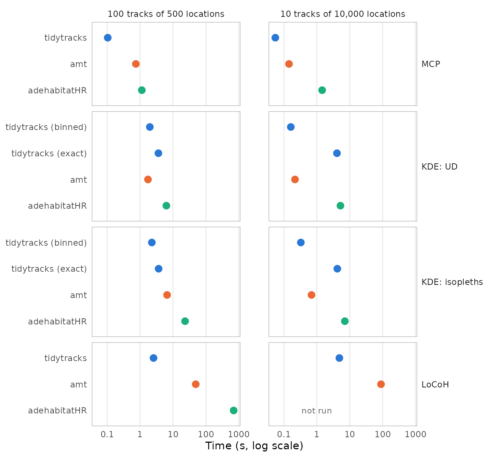
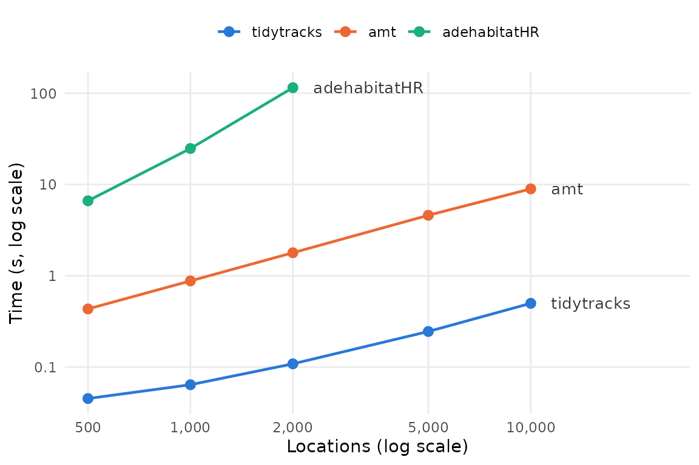
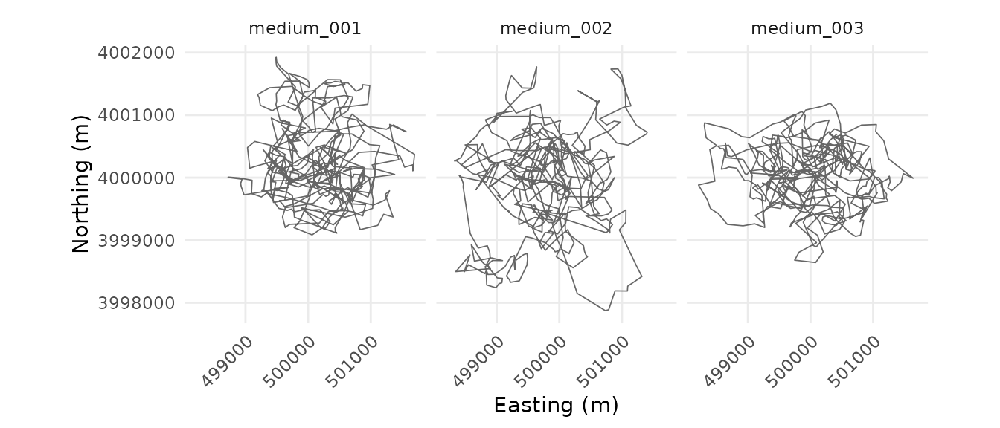

# Benchmarking home ranges against amt and adehabitatHR

`tidytracks`, `amt` (Signer et al. 2019) and `adehabitatHR` (Calenge
2006) can all estimate home ranges with minimum convex polygons (MCP),
kernel density estimation (KDE) and local convex hulls (LoCoH). This
article compares how long they take, on tracks simulated with `amt`, and
checks that, given the same settings, they give the same home ranges.

The [results](#results) come first. The second part, [How the benchmark
was run](#how-the-benchmark-was-run), describes the simulated tracks and
the benchmark, with their code, and how to run it again.

## Results

### Summary

- Given the same settings, the three packages give the same MCP and
  LoCoH home ranges. The KDE isopleths of `adehabitatHR`, and those of
  the binned method of `tidytracks`, are within about 0.1% of the exact
  ones of `tidytracks`, and those of `amt` within about 1%, as its grid
  points are not at the centres of the cells.
- `tidytracks` is the fastest for MCP and LoCoH (more than 10 times
  faster than `amt`, and more than 100 times faster than `adehabitatHR`,
  for LoCoH), and, with its default binned method, for the KDE isopleths
  (2 to 3 times faster than `amt`).
- For the UDs of long tracks, the binned methods of `tidytracks` and
  `amt` are the fastest (`tidytracks` slightly faster), more than 20
  times faster than the exact methods.
- LoCoH in `adehabitatHR` becomes impractical beyond a few thousand
  locations per track.

The packages are compared on two data sets of tracks simulated with
`amt`: many tracks of medium length (100 tracks of 500 locations), and a
few long tracks (10 tracks of 10,000 locations), with the same settings
in all the packages (see [The data sets](#the-data-sets) and [Running
the estimators](#running-the-estimators)).

### Do the packages give the same home ranges?

For each method, data set and level, we compare the area of the home
range of each track from each estimator with the area from `tidytracks`
(with its exact method, for the KDE):

| Method | Estimator | Level | Median difference (%) | Largest difference (%) |
|:---|:---|:---|---:|---:|
| MCP | amt | 50% | 0 | 0 |
| MCP | amt | 95% | 0 | 0 |
| MCP | adehabitatHR | 50% | 0 | 0 |
| MCP | adehabitatHR | 95% | 0 | 0 |
| KDE | tidytracks (binned) | 50% | 0.044 | 0.11 |
| KDE | tidytracks (binned) | 95% | 0.039 | 0.14 |
| KDE | amt | 50% | 0.97 | 1.1 |
| KDE | amt | 95% | 0.98 | 1.1 |
| KDE | adehabitatHR | 50% | 0.0085 | 0.015 |
| KDE | adehabitatHR | 95% | 0.048 | 0.079 |
| LoCoH | amt | 50% | \< 0.001 | \< 0.001 |
| LoCoH | amt | 95% | \< 0.001 | \< 0.001 |
| LoCoH | adehabitatHR | 50% | 0 | 0 |
| LoCoH | adehabitatHR | 95% | 0 | 0 |

MCP and LoCoH give the same home ranges in all three packages (the tiny
differences for LoCoH in `amt` come from its buffering of each hull by
0.00001 m). For the KDE, the isopleths of `adehabitatHR` are within
0.079% of the exact ones of `tidytracks`: both evaluate the same kernels
at the same points, and differ only in how they draw the isopleths from
the UDs. The binned estimators approximate the KDE, as binning moves
each location by less than a cell: the binned isopleths of `tidytracks`
are within 0.14% of the exact ones, and those of `amt` within 1.1%. Both
bin the locations in the same way, and smooth them with the same kernel,
but `amt` (with
[`KernSmooth::bkde2D()`](https://rdrr.io/pkg/KernSmooth/man/bkde2D.html))
estimates the density at grid points that go from edge to edge of its
raster, rather than at the centres of its cells: they are slightly more
than a cell apart, so its UD is stretched by up to half a cell towards
the edges of the grid.

### How long do they take?



| Data set | Method | tidytracks | tidytracks (exact KDE) | amt | adehabitatHR |
|:---|:---|---:|---:|---:|---:|
| 100 tracks of 500 locations | MCP | 0.1 |  | 0.74 | 1.1 |
| 100 tracks of 500 locations | KDE: UD | 2 | 3.6 | 1.7 | 6.3 |
| 100 tracks of 500 locations | KDE: isopleths | 2.3 | 3.7 | 6.6 | 23 |
| 100 tracks of 500 locations | LoCoH | 2.6 |  | 49 | 700 |
| 10 tracks of 10,000 locations | MCP | 0.055 |  | 0.14 | 1.5 |
| 10 tracks of 10,000 locations | KDE: UD | 0.16 | 4.1 | 0.22 | 5.2 |
| 10 tracks of 10,000 locations | KDE: isopleths | 0.33 | 4.2 | 0.69 | 7.1 |
| 10 tracks of 10,000 locations | LoCoH | 4.8 |  | 89 | not run |

Time (s) to estimate the home ranges of all the tracks. For the KDE, the
column tidytracks is for its default, binned, method. {.table}

- **MCP** takes at most about a second in all three packages.
  `tidytracks` is the fastest: `amt` takes 7.2 times as long on the
  medium tracks, and `adehabitatHR` 11 times (26 times on the long
  tracks).
- **KDE**: the exact estimators (`tidytracks` with `method = "exact"`,
  and `adehabitatHR`) evaluate the kernel of every location in every
  cell of the grid, which takes a time proportional to the number of
  locations times the number of cells, whilst the binned estimators
  (`tidytracks` with its default, `method = "binned"`, and `amt`) first
  bin the locations onto the grid, so that their time hardly depends on
  the number of locations. On the long tracks, the binned estimators are
  thus much faster: the UDs take 0.16 s with `tidytracks` and 0.22 s
  with `amt`, against 4.1 s with the exact method of `tidytracks` (25
  times as long) and 5.2 s with `adehabitatHR`. On the medium tracks,
  which have fewer locations, the kernels take less time than building
  the UD of each track: `tidytracks` (with either method) and `amt` take
  1.7 to 3.6 s, and `adehabitatHR` 6.3 s. Drawing the isopleths of the
  medium tracks adds little to the time of `tidytracks`, which draws
  them straight from the UDs, without building rasters (0.3 s with the
  binned method), but 4.9 s to that of `amt`, and 17 s to that of
  `adehabitatHR`. From the locations to the isopleths, the binned method
  of `tidytracks` is thus the fastest on both data sets: `amt` takes 2.1
  to 2.9 times as long, and `adehabitatHR` 10 to 22 times. Most of the
  time of the exact method of `tidytracks` on long tracks is spent in a
  matrix product (in
  [`MASS::kde2d()`](https://rdrr.io/pkg/MASS/man/kde2d.html)), which an
  optimised BLAS (such as OpenBLAS) can make several times faster, as it
  can the matrix products of the binned method; this benchmark used the
  reference BLAS of R.
- **LoCoH**: `tidytracks` is the fastest, by far: `amt` takes 18 to 19
  times as long, and `adehabitatHR` 270 times as long on the medium
  tracks (12 minutes, against 2.6 s). `LoCoH.k()` from `adehabitatHR`
  was not run on the long tracks, as it would take hours (see below).

### LoCoH on a single track



The time taken by `tidytracks` and `amt` grows about linearly with the
number of locations, whilst that of `adehabitatHR`, which computes the
distances between all pairs of locations (in R), roughly quadruples each
time the number of locations doubles. A track of 10,000 locations would
thus take it about 50 minutes, and the 10 long tracks about 8 hours,
against 0.5 s per track for `tidytracks`.

## How the benchmark was run

The benchmark takes about 35 minutes to run, so it was run once with the
script `vignettes/articles/code/hr_packages_benchmark.R` (in the source
code of the package), and its results are read here from the directory
`vignettes/articles/data`. It uses tracks simulated beforehand with the
script `vignettes/articles/code/hr_benchmark_tracks.R`, and stored in
the same directory, so it can be run again (e.g. on another machine)
without simulating them. The code shown below is taken from these two
scripts. Timings depend on the machine (see [Machine and
software](#machine-and-software)), but the differences between the
packages should be similar on other machines.

The benchmark uses these packages:

``` r

library(tidytracks)
# amt and adehabitatHR are not attached: their functions are called with ::,
# to make clear which package each of them comes from
```

### Simulating tracks with amt

`amt` can simulate movement from an integrated step selection function
(iSSF; Avgar et al. 2016), which combines a movement kernel (the
distributions of step lengths and turning angles) with the selection of
the places where steps end. To get tracks that stay within a home range,
the selection decreases with the squared distance from a centre:

``` r

# amt simulates movement from a redistribution kernel, which needs a map of
# the landscape; this one is uniform, as the model below only depends on the
# position of the animal
landscape <- terra::rast(
  xmin = -20000, xmax = 20000, ymin = -20000, ymax = 20000,
  resolution = 100, crs = "EPSG:32630", vals = 0, names = "habitat"
)
# an integrated step selection model: step lengths with a gamma distribution
# (200 m per hour on average), turning angles with a von Mises distribution
# (some directional persistence), and selection against locations far from
# the centre of the home range, at (0, 0)
movement_model <- amt::make_issf_model(
  coefs = c("I(x2_^2 + y2_^2)" = -1e-6),
  sl = amt::make_gamma_distr(shape = 2, scale = 100),
  ta = amt::make_vonmises_distr(kappa = 1)
)

# simulate a track with one location per hour
simulate_track <- function(id, n_locations, seed) {
  set.seed(seed)
  start <- amt::make_start(
    c(0, 0),
    time = as.POSIXct("2024-01-01", tz = "UTC"),
    crs = 32630
  )
  kernel <- amt::redistribution_kernel(
    movement_model,
    start = start,
    map = landscape,
    # the model only uses the coordinates at the end of each step, so the
    # landscape does not need to be queried
    fun = function(xy, map) xy,
    # the number of candidate steps drawn at each step (the default, 1e6, is
    # much slower)
    n.control = 1e3
  )
  path <- amt::simulate_path(kernel, n.steps = n_locations - 1)
  data.frame(
    id = id,
    # moved to the centre of UTM zone 30N
    x = path$x_ + 500000,
    y = path$y_ + 4000000,
    time = path$t_
  )
}
```

For example, the first three tracks of the first data set below:

``` r

example_tracks <- lapply(1:3, function(i) {
  simulate_track(
    id = sprintf("medium_%03d", i),
    n_locations = 500,
    seed = 1000 + i
  )
})
example_tracks <- do.call(rbind, example_tracks)
```

``` r

ggplot(example_tracks, aes(x, y)) +
  geom_path(colour = "grey40", linewidth = 0.3) +
  facet_wrap(~id) +
  coord_equal() +
  labs(x = "Easting (m)", y = "Northing (m)") +
  theme_minimal() +
  theme(
    axis.text.x = element_text(angle = 45, hjust = 1),
    panel.grid.minor = element_blank()
  )
```



### The data sets

We simulate two data sets, with the same model: many tracks of medium
length, and a few long tracks (with one location per hour, about three
weeks and fourteen months of tracking respectively):

``` r

# the number of tracks and of locations per track of each data set
sizes <- list(
  medium = c(tracks = 100, locations = 500),
  long = c(tracks = 10, locations = 10000)
)

# simulate the tracks of a data set in parallel (with forked processes, which
# are not available on Windows), each track with its own seed
simulate_dataset <- function(name) {
  size <- sizes[[name]]
  tracks <- parallel::mclapply(
    seq_len(size[["tracks"]]),
    function(i) {
      simulate_track(
        id = sprintf("%s_%03d", name, i),
        n_locations = size[["locations"]],
        seed = 1000 * match(name, names(sizes)) + i
      )
    },
    mc.cores = parallel::detectCores()
  )
  # a failed simulation returns an error instead of a data frame
  stopifnot(all(vapply(tracks, is.data.frame, logical(1))))
  do.call(rbind, tracks)
}
```

Simulating the tracks takes about 8 minutes on 4 cores: each step takes
about 10 ms, mostly in the bookkeeping of `amt` rather than in the
simulation itself. So the tracks were simulated once (with
`code/hr_benchmark_tracks.R`) and stored in
`data/hr_benchmark_tracks.rds`, from which the benchmark reads them:

``` r

# the tracks simulated by hr_benchmark_tracks.R: a list of two data frames
# (medium and long) with the id, coordinates (x and y, in EPSG:32630) and time
# of each location
datasets <- readRDS("data/hr_benchmark_tracks.rds")
```

### Running the estimators

Each package works on its own class of objects: a `move2` object for
`tidytracks`, a `track_xy` for `amt` and a `SpatialPointsDataFrame`
(from `sp`) for `adehabitatHR`. These are built from the data frame of
each data set (outside of the timings):

``` r

# the input of each package, built from a data frame of locations
make_inputs <- function(df) {
  list(
    tidytracks = mt_as_move2(
      sf::st_as_sf(df, coords = c("x", "y"), crs = 32630),
      time_column = "time",
      track_id_column = "id"
    ),
    # nolint next: object_usage_linter.
    amt = amt::make_track(df, x, y, time, id = id, crs = 32630),
    adehabitatHR = sp::SpatialPointsDataFrame(
      df[, c("x", "y")],
      data = data.frame(id = factor(df$id)),
      proj4string = sp::CRS("EPSG:32630")
    )
  )
}
```

The KDEs are estimated on the same grid for all the packages:

``` r

# the grid on which the KDEs of all the tracks are estimated: the extent of
# all the locations, extended on each side by half its longest side, with 200
# cells along its longest side. It is given to each package in its own way:
# a bounding box and a resolution for tidytracks, a raster for amt, and the
# centres of its cells for adehabitatHR.
make_grid <- function(df) {
  side <- max(diff(range(df$x)), diff(range(df$y)))
  raster <- terra::rast(
    xmin = min(df$x) - side / 2,
    xmax = max(df$x) + side / 2,
    ymin = min(df$y) - side / 2,
    ymax = max(df$y) + side / 2,
    resolution = side / 100,
    crs = "EPSG:32630"
  )
  centres <- terra::xyFromCell(raster, seq_len(terra::ncell(raster)))
  list(
    bbox = c(
      xmin = terra::xmin(raster),
      ymin = terra::ymin(raster),
      xmax = terra::xmax(raster),
      ymax = terra::ymax(raster)
    ),
    res = terra::res(raster)[1],
    raster = raster,
    pixels = sp::SpatialPixels(
      sp::SpatialPoints(centres, proj4string = sp::CRS("EPSG:32630"))
    )
  )
}
```

The home ranges are then estimated with each method and package, at the
50% and 95% levels, and with both of the methods of `tidytracks` for the
KDE (see below). `tidytracks` and `adehabitatHR` estimate the home
ranges of all the tracks in one call; `amt` estimates the home range of
a single track, so its estimators are applied to each track in turn,
after nesting the tracks as shown in the documentation of `amt`:

``` r

iso_levels <- c(0.5, 0.95)

# The home range of each track, with each method and estimator, from the
# input of its package (all the tracks) and the grid for the KDE. Each
# estimator is named after its package (its first word), followed, for the
# KDE of tidytracks, by its method. amt estimates the home range of a single
# track, so it is applied to each track in turn.
estimators <- list(
  mcp = list(
    tidytracks = function(input, grid) {
      hr_tt_mcp(input, levels = iso_levels)
    },
    amt = function(input, grid) {
      input |>
        tidyr::nest(data = -id) |>
        dplyr::mutate(hr = purrr::map(data, amt::hr_mcp, levels = iso_levels))
    },
    # adehabitatHR estimates a single level at a time
    adehabitatHR = function(input, grid) {
      lapply(iso_levels, function(level) {
        adehabitatHR::mcp(input, percent = 100 * level, unout = "m2")
      })
    }
  ),
  # the UDs, with the reference bandwidth of each track, and tidytracks with
  # both of its methods: binned (its default, which bins the locations onto
  # the grid before smoothing them, as amt does) and exact (which evaluates
  # the kernel of every location at every cell, as adehabitatHR does)
  kde_ud = list(
    "tidytracks (binned)" = function(input, grid) {
      hr_tt_kde(
        input,
        h = "h_ref_indiv",
        bbox = grid$bbox,
        res = grid$res,
        method = "binned"
      )
    },
    "tidytracks (exact)" = function(input, grid) {
      hr_tt_kde(
        input,
        h = "h_ref_indiv",
        bbox = grid$bbox,
        res = grid$res,
        method = "exact"
      )
    },
    amt = function(input, grid) {
      input |>
        tidyr::nest(data = -id) |>
        dplyr::mutate(hr = purrr::map(data, amt::hr_kde, trast = grid$raster))
    },
    adehabitatHR = function(input, grid) {
      adehabitatHR::kernelUD(input, h = "href", grid = grid$pixels)
    }
  ),
  # the isopleths, starting from the locations (i.e. including the UDs)
  kde_iso = list(
    "tidytracks (binned)" = function(input, grid) {
      hr_tt_kde(
        input,
        h = "h_ref_indiv",
        bbox = grid$bbox,
        res = grid$res,
        levels = iso_levels,
        method = "binned"
      )
    },
    "tidytracks (exact)" = function(input, grid) {
      hr_tt_kde(
        input,
        h = "h_ref_indiv",
        bbox = grid$bbox,
        res = grid$res,
        levels = iso_levels,
        method = "exact"
      )
    },
    amt = function(input, grid) {
      input |>
        tidyr::nest(data = -id) |>
        dplyr::mutate(hr = purrr::map(data, function(track) {
          ud <- amt::hr_kde(track, trast = grid$raster, levels = iso_levels)
          amt::hr_isopleths(ud)
        }))
    },
    adehabitatHR = function(input, grid) {
      ud <- adehabitatHR::kernelUD(input, h = "href", grid = grid$pixels)
      lapply(iso_levels, function(level) {
        adehabitatHR::getverticeshr(ud, percent = 100 * level, unout = "m2")
      })
    }
  ),
  # hulls of each location and its 10 nearest neighbours
  locoh = list(
    tidytracks = function(input, grid) {
      hr_tt_locoh(input, n = 10, type = "k", levels = iso_levels)
    },
    amt = function(input, grid) {
      input |>
        tidyr::nest(data = -id) |>
        dplyr::mutate(
          hr = purrr::map(data, amt::hr_locoh, n = 10, levels = iso_levels)
        )
    },
    # adehabitatHR counts the location itself in k, so k = 11 gives the
    # same hulls; it returns the union of the hulls at every step, from which
    # the isopleths are picked (see areas below)
    adehabitatHR = function(input, grid) {
      adehabitatHR::LoCoH.k(input, k = 11, unout = "m2")
    }
  )
)
```

The settings are matched so that the packages estimate the same home
ranges:

- **MCP**: all three packages exclude the locations farthest from the
  mean of the locations, and build the convex hull of the others.
- **KDE**: all three use a bivariate normal kernel, with the reference
  bandwidth of each track
  ($`h = \sqrt{(\sigma^2_x + \sigma^2_y)/2} \, n^{-1/6}`$), on the same
  grid. The UDs are timed on their own (`kde_ud`), and with their
  isopleths (`kde_iso`, i.e. from the locations to the isopleths). The
  UD on a grid can be estimated in two ways. The exact estimators
  evaluate the kernel of every location at the centre of every cell:
  those of `adehabitatHR`, and of `tidytracks` with `method = "exact"`
  (which uses
  [`MASS::kde2d()`](https://rdrr.io/pkg/MASS/man/kde2d.html)). The
  binned estimators first bin the locations onto the grid (splitting
  each location between the four cells whose centres surround it), and
  then smooth the bin counts with the kernel, which is faster but
  approximate: those of `amt` (with
  [`KernSmooth::bkde2D()`](https://rdrr.io/pkg/KernSmooth/man/bkde2D.html),
  which smooths them with fast Fourier transforms), and of `tidytracks`
  with `method = "binned"`, its default (which bins the locations as
  [`KernSmooth::bkde2D()`](https://rdrr.io/pkg/KernSmooth/man/bkde2D.html)
  does, but smooths them with two matrix products, one along each axis
  of the grid, as the Gaussian kernel is separable).
- **LoCoH**: hulls of each location and its 10 nearest neighbours
  (`n = 10` in `tidytracks` and `amt`, `k = 11` in `adehabitatHR`, which
  counts the location itself). For each level, the isopleth is the union
  of the smallest hulls whose coverage (the proportion of locations in
  the hulls) is closest to the level.

Each estimator is run once, and, if that took less than a minute, five
more times, of which the median time is reported:

``` r

# Time an estimator: a first run, which also gives its results, then, if it
# took less than a minute, 5 more runs, whose median time is reported.
time_estimator <- function(estimator, input, grid) {
  start <- bench::hires_time()
  result <- estimator(input, grid)
  seconds <- as.numeric(bench::hires_time() - start)
  runs <- 1
  if (seconds < 60) {
    timing <- bench::mark(
      estimator(input, grid),
      iterations = 5,
      check = FALSE,
      memory = FALSE,
      filter_gc = FALSE
    )
    seconds <- as.numeric(timing$median)
    runs <- 5
  }
  list(result = result, seconds = seconds, runs = runs)
}
```

``` r

timings <- list()
area_results <- list()
for (dataset in names(datasets)) {
  df <- datasets[[dataset]]
  inputs <- make_inputs(df)
  grid <- make_grid(df)
  n_tracks <- length(unique(df$id))
  for (method in names(estimators)) {
    for (estimator in names(estimators[[method]])) {
      # the package of the estimator, i.e. the first word of its name (e.g.
      # tidytracks for "tidytracks (exact)"), which gives its input and how
      # to extract its areas
      package <- sub(" .*", "", estimator)
      # LoCoH in adehabitatHR would take hours on the long tracks (see the
      # scaling below)
      if (method == "locoh" && package == "adehabitatHR" && dataset == "long") {
        next
      }
      message("Timing ", dataset, ", ", method, ", ", estimator)
      timed <- time_estimator(
        estimators[[method]][[estimator]],
        inputs[[package]],
        grid
      )
      timings[[length(timings) + 1]] <- data.frame(
        dataset = dataset,
        tracks = n_tracks,
        locations = nrow(df) / n_tracks,
        method = method,
        package = package,
        estimator = estimator,
        seconds = timed$seconds,
        runs = timed$runs
      )
      if (method %in% names(areas)) {
        area_results[[length(area_results) + 1]] <- data.frame(
          dataset = dataset,
          method = method,
          package = package,
          estimator = estimator,
          areas[[method]][[package]](timed$result)
        )
      }
    }
  }
}
timings <- do.call(rbind, timings)
area_results <- do.call(rbind, area_results)
```

The areas of the home ranges are then extracted from the results of each
package (with the functions in `areas`, in the script). `LoCoH.k()` from
`adehabitatHR` is not run on the long tracks: it would take hours (see
[LoCoH on a single track](#locoh-on-a-single-track)).

### From the results to the tables and plots

The benchmark saves its results in `data/hr_benchmark_*.csv`, which are
read and summarised for the [results](#results) above with this code:

``` r

# to summarise and plot the results
library(dplyr)
library(tidyr)
library(ggplot2)
area_results <- read.csv("data/hr_benchmark_areas.csv")
# the estimators, in the order of the tables and plots
estimator_levels <- c(
  "tidytracks", "tidytracks (binned)", "tidytracks (exact)",
  "amt", "adehabitatHR"
)
# the estimators with which the others are compared
reference_estimators <- c("tidytracks", "tidytracks (exact)")
area_diff <- area_results %>%
  filter(!estimator %in% reference_estimators) %>%
  inner_join(
    area_results %>%
      filter(estimator %in% reference_estimators) %>%
      select(dataset, method, id, level, area_reference = area),
    by = c("dataset", "method", "id", "level")
  ) %>%
  # the relative difference, in %
  mutate(diff = 100 * abs(area / area_reference - 1)) %>%
  group_by(method, estimator, level) %>%
  summarise(
    median_diff = median(diff),
    max_diff = max(diff),
    .groups = "drop"
  )
timings <- read.csv("data/hr_benchmark_timings.csv")
# labels for the plots and tables
method_labels <- c(
  mcp = "MCP",
  kde_ud = "KDE: UD",
  kde_iso = "KDE: isopleths",
  locoh = "LoCoH"
)
package_levels <- c("tidytracks", "amt", "adehabitatHR")
timings <- timings %>%
  mutate(
    data_set = paste(
      tracks, "tracks of",
      format(locations, big.mark = ",", trim = TRUE), "locations"
    ),
    data_set = factor(data_set, unique(data_set)),
    method = factor(method_labels[method], method_labels),
    package = factor(package, package_levels),
    estimator = factor(estimator, estimator_levels)
  )
locoh_scaling <- read.csv("data/hr_benchmark_locoh_scaling.csv") %>%
  mutate(package = factor(package, package_levels))
```

and the plots of the timings are drawn with:

``` r

# one colour per package (and the name of each estimator on the y axis)
package_colours <- c(
  tidytracks = "#2a78d6",
  amt = "#eb6834",
  adehabitatHR = "#1baf7a"
)
ggplot(timings, aes(x = seconds, y = estimator, colour = package)) +
  geom_point(size = 3) +
  # the combinations that were not run
  geom_text(
    data = timings %>%
      complete(data_set, nesting(method, estimator, package)) %>%
      filter(is.na(seconds)),
    aes(x = 1, label = "not run"),
    colour = "grey40",
    size = 3
  ) +
  # each method with its own estimators
  facet_grid(method ~ data_set, scales = "free_y", space = "free_y") +
  scale_x_log10(
    breaks = c(0.1, 1, 10, 100, 1000),
    labels = c("0.1", "1", "10", "100", "1000")
  ) +
  scale_y_discrete(limits = rev) +
  scale_colour_manual(values = package_colours, guide = "none") +
  labs(x = "Time (s, log scale)", y = NULL) +
  theme_minimal() +
  theme(
    panel.grid.minor = element_blank(),
    panel.grid.major.y = element_blank(),
    panel.spacing.x = unit(2, "lines"),
    strip.text.y = element_text(angle = 0, hjust = 0),
    panel.border = element_rect(
      colour = "grey70",
      fill = NA,
      linewidth = 0.5
    )
  )
ggplot(locoh_scaling, aes(x = locations, y = seconds, colour = package)) +
  geom_line(linewidth = 0.8) +
  geom_point(size = 2.5) +
  # each line labelled at its last point
  geom_text(
    data = locoh_scaling %>%
      group_by(package) %>%
      filter(locations == max(locations)),
    aes(label = package),
    hjust = 0,
    # in log10 units, as the x axis is on a log scale
    nudge_x = 0.06,
    colour = "grey20",
    size = 3.5
  ) +
  scale_x_log10(
    breaks = c(500, 1000, 2000, 5000, 10000),
    labels = c("500", "1,000", "2,000", "5,000", "10,000"),
    expand = expansion(mult = c(0.05, 0.3))
  ) +
  scale_y_log10(
    breaks = c(0.1, 1, 10, 100),
    labels = c("0.1", "1", "10", "100")
  ) +
  scale_colour_manual(values = package_colours) +
  labs(
    x = "Locations (log scale)",
    y = "Time (s, log scale)",
    colour = NULL
  ) +
  theme_minimal() +
  theme(panel.grid.minor = element_blank(), legend.position = "top")
```

### Running the benchmark again

To run the benchmark again (e.g. after changing `tidytracks`, or on
another machine), install `tidytracks` (with `R CMD INSTALL`, rather
than loading it with `devtools::load_all()`, which compiles its C++ code
without optimisation), `amt`, `adehabitatHR`, `sp` and `bench`, and run,
on an otherwise idle machine:

``` sh
cd vignettes/articles
Rscript code/hr_packages_benchmark.R
```

which overwrites `data/hr_benchmark_*.csv`; then render this article
again. `Rscript code/hr_packages_benchmark.R quick` runs everything on
the first locations of a few tracks, to check the script, and saves its
results in a temporary directory instead. The simulated tracks are only
needed again for a different simulation:
`Rscript code/hr_benchmark_tracks.R` simulates them and overwrites
`data/hr_benchmark_tracks.rds`.

### Machine and software

|              |                                           |
|:-------------|:------------------------------------------|
| date         | 2026-10-28                                |
| R            | R version 4.6.1 (2026-06-24)              |
| platform     | x86_64-pc-linux-gnu                       |
| CPU          | Intel(R) Core(TM) i7-10510U CPU @ 1.80GHz |
| cores        | 4                                         |
| BLAS         | libblas.so.3                              |
| tidytracks   | 0.2.1.9004                                |
| amt          | 0.3.1.0                                   |
| adehabitatHR | 0.4.22                                    |
| sf           | 1.1.3                                     |
| GEOS         | 3.12.1                                    |
| terra        | 1.9.50                                    |
| MASS         | 7.3.66                                    |
| KernSmooth   | 2.23.27                                   |

## References

Avgar, T., Potts, J. R., Lewis, M. A. & Boyce, M. S. (2016). Integrated
step selection analysis: bridging the gap between resource selection and
animal movement. *Methods in Ecology and Evolution*, 7, 619-630.

Calenge, C. (2006). The package “adehabitat” for the R software: a tool
for the analysis of space and habitat use by animals. *Ecological
Modelling*, 197, 516-519.

Signer, J., Fieberg, J. & Avgar, T. (2019). Animal movement tools (amt):
R package for managing tracking data and conducting habitat selection
analyses. *Ecology and Evolution*, 9, 880-890.
