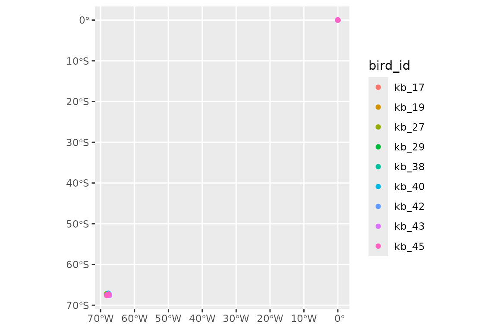
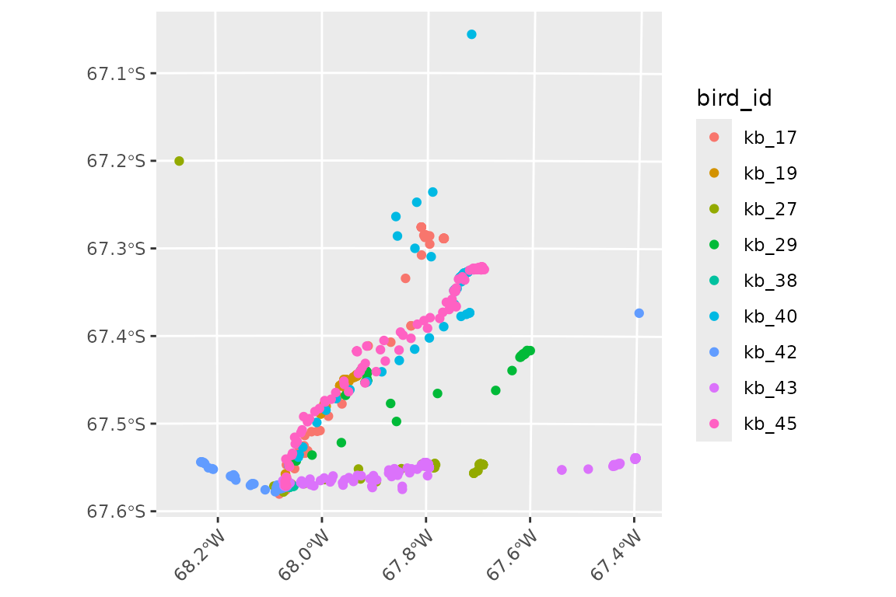
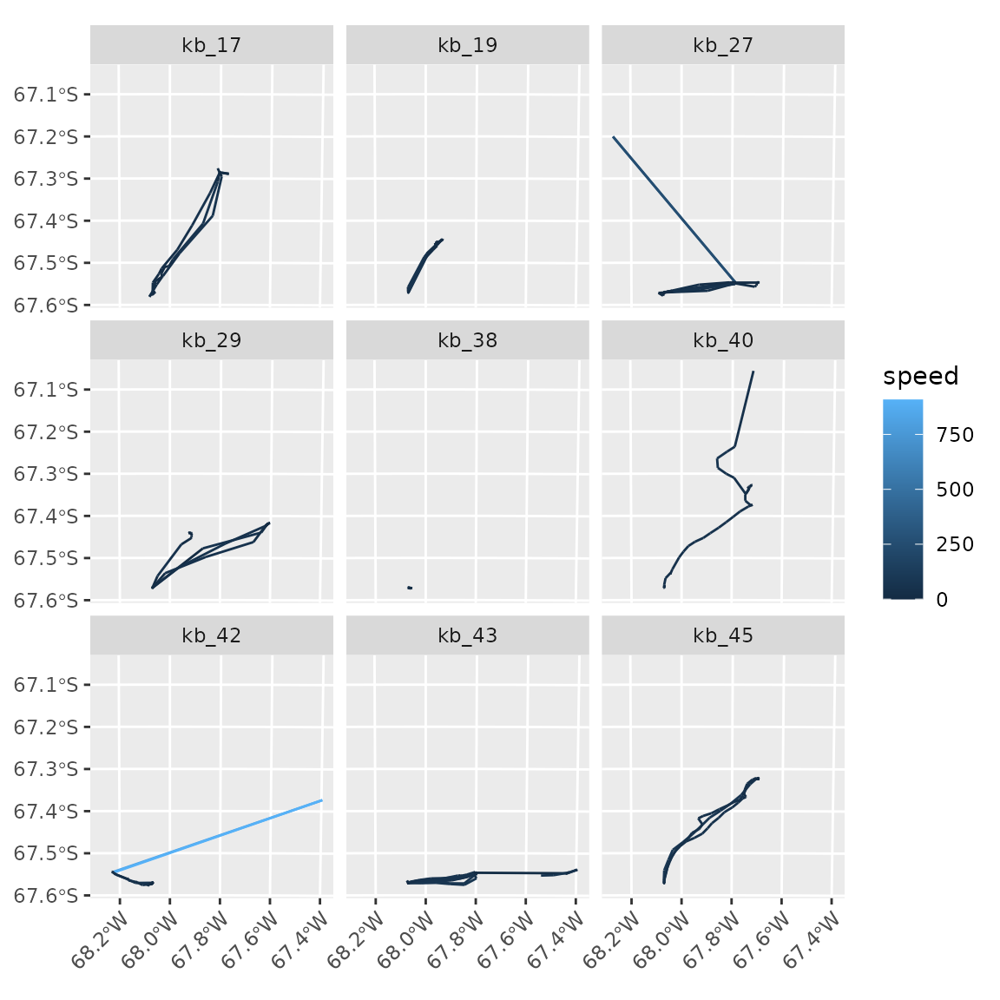
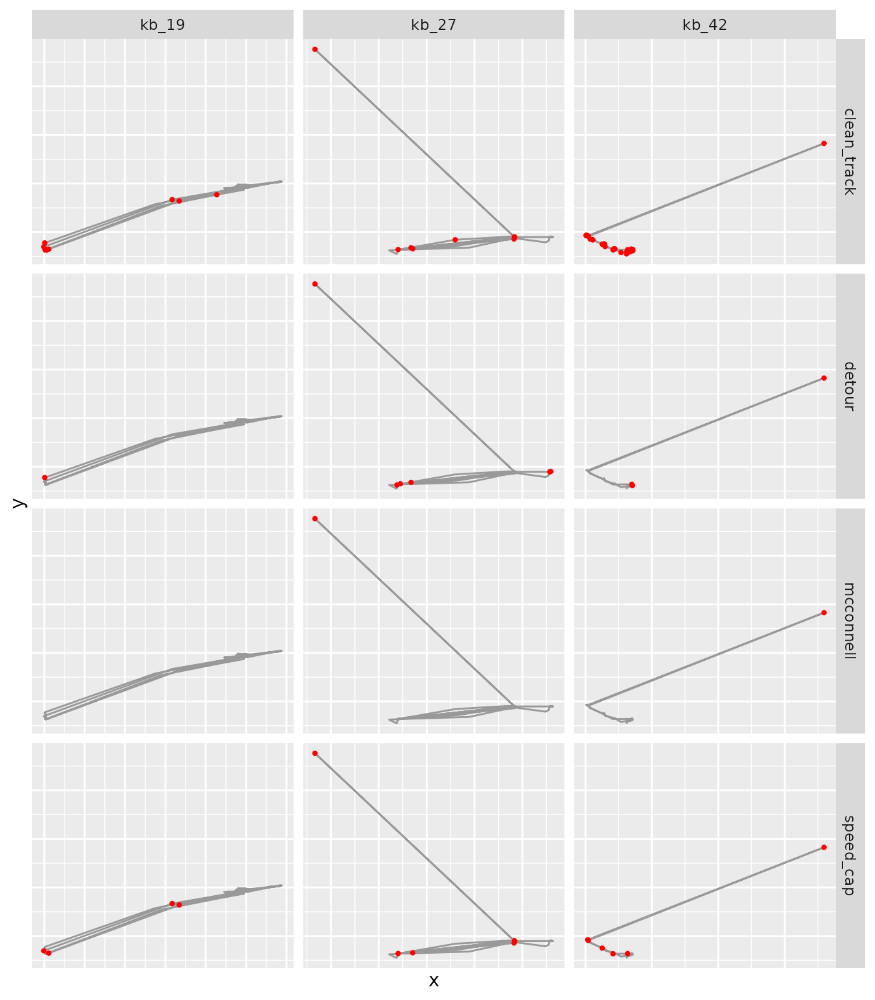
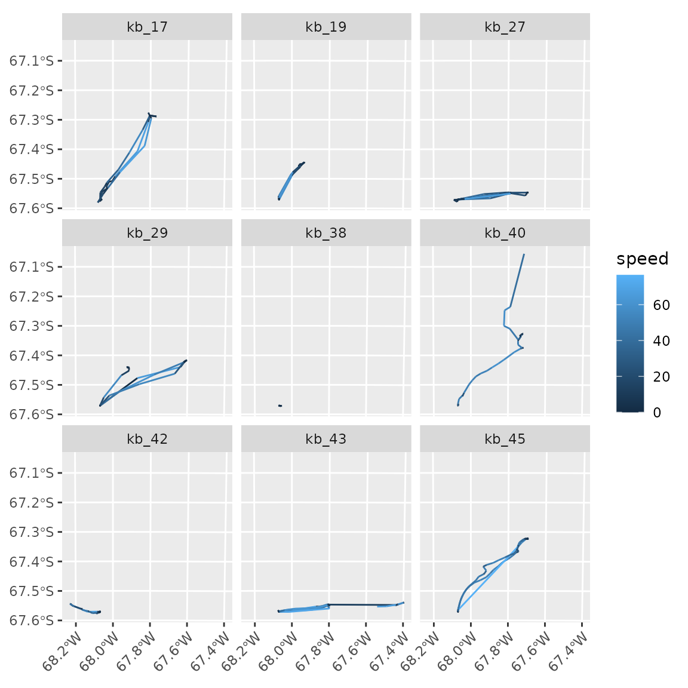
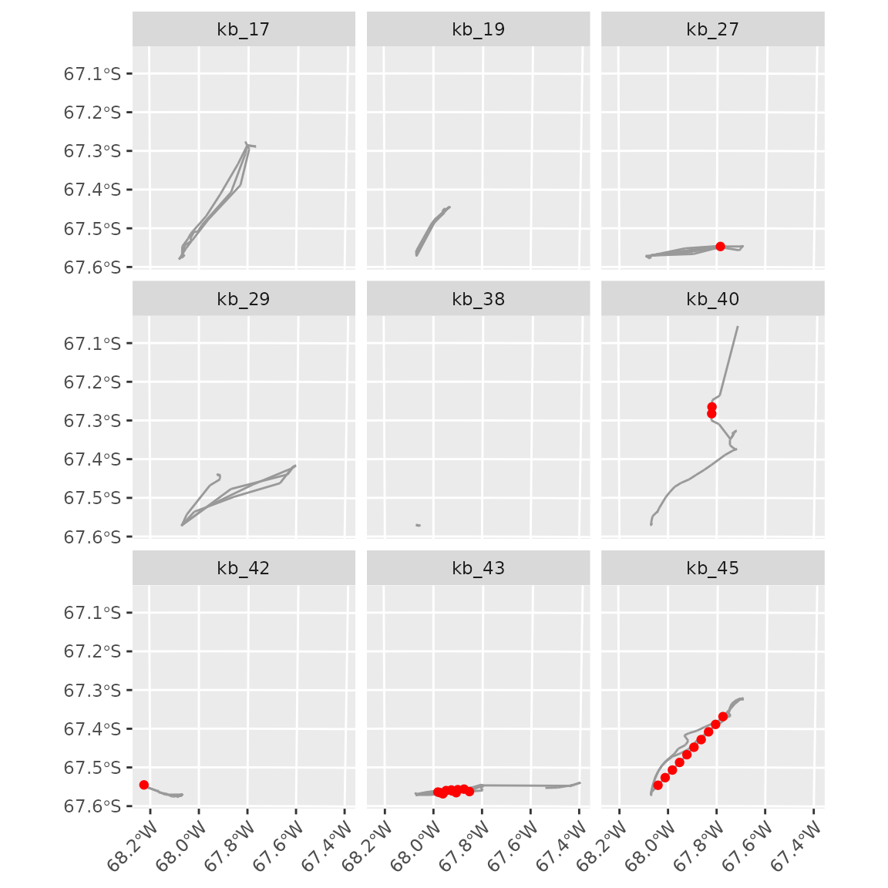
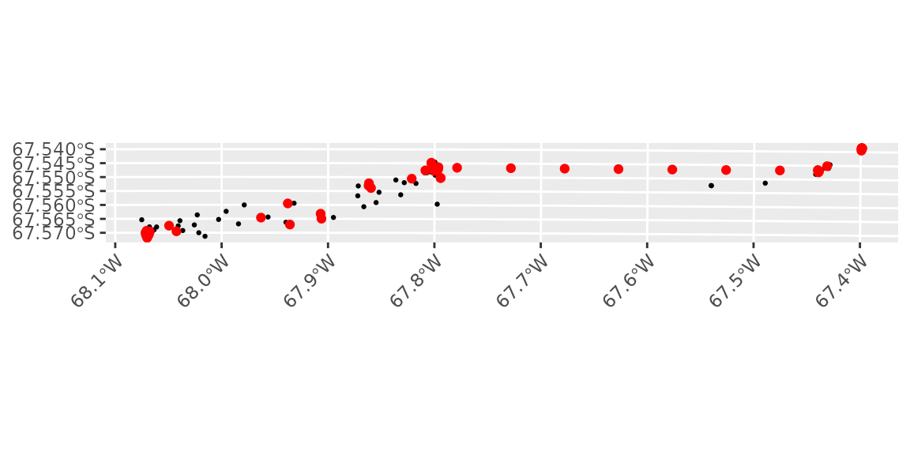
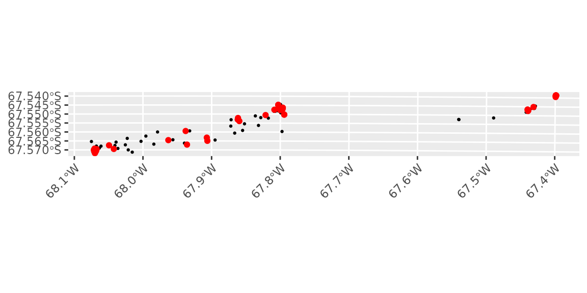

# Reading and cleaning data

Data from tracking devices are rarely ready for analysis. Loggers may
fail to get a fix and record a dummy location instead, the same record
may be downloaded twice, some locations may be far from the true
position of the animal, and the interval between fixes may vary. This
article shows how to read tracking data into a tibble of tracks, and how
to find and fix these problems, one step at a time, inspecting the data
after each step.

We use the Antarctic shag tracks from the main vignette
([`vignette("tidytracks")`](https://evolecolgroup.github.io/tidytracks/dev/articles/tidytracks.md)),
to which we added some of the errors that are typical of raw tracking
data. Remember that these data were modified to show the functionality
of `tidytracks`, and should not be used for analyses of shag movement.
All the files used in this article are in the directory
`vignettes/articles/data` of the source code of the package.

``` r

library(tidytracks)
library(dplyr)
library(ggplot2)
library(sf)
```

## Reading data

[`tt_read_data()`](https://evolecolgroup.github.io/tidytracks/dev/reference/tt_read_data.md)
reads a table of events from a CSV file (or from a `data.frame`). The
table must have a column identifying the track of each event, two
columns with the coordinates, and the date-time of each event, either in
a single column or in separate date and time columns (see the main
vignette for more details).

### Date-time formats

Date-times are stored in many different formats. If `format_date_time`
is not given,
[`tt_read_data()`](https://evolecolgroup.github.io/tidytracks/dev/reference/tt_read_data.md)
tries a set of common formats: dates as year-month-day, day/month/year
or month/day/year (with `/` or `-` as separators), followed by the time
as hours:minutes:seconds or hours:minutes. To see how this works, we use
three small files with the first five locations of bird `kb_17`, each
with its date-times in a different format.

#### Separate date and time columns

In the first file, the date (as day/month/year) and the time are in
separate columns:

``` r

read.csv("data/shags_dates_dmy.csv")
#>   bird_id       date     time       lon       lat
#> 1   kb_17 04/01/2022 00:09:13 -68.06908 -67.57072
#> 2   kb_17 04/01/2022 00:19:07 -68.06889 -67.57077
#> 3   kb_17 04/01/2022 00:29:06 -68.06904 -67.57065
#> 4   kb_17 04/01/2022 00:39:05 -68.06894 -67.57073
#> 5   kb_17 04/01/2022 00:49:04 -68.06892 -67.57067
```

We give both columns to `col_date_time`, and they are combined into a
single `date_time` column:

``` r

shags_dmy <- tt_read_data(
  events = "data/shags_dates_dmy.csv",
  col_track_id = "bird_id",
  col_coords = c("lon", "lat"),
  col_date_time = c("date", "time")
)
```

``` r

event_time(shags_dmy)
#> [1] "2022-01-04 00:09:13 UTC" "2022-01-04 00:19:07 UTC"
#> [3] "2022-01-04 00:29:06 UTC" "2022-01-04 00:39:05 UTC"
#> [5] "2022-01-04 00:49:04 UTC"
```

The format was detected correctly. Note that, by default, date-times are
assumed to be in UTC (`time_zone = "UTC"`), and coordinates to be
longitude and latitude on WGS 84 (`crs = 4326`).

#### Month/day/year dates

In the second file, the dates are given as month/day/year:

``` r

read.csv("data/shags_dates_mdy.csv")
#>   bird_id           date_time       lon       lat
#> 1   kb_17 01/04/2022 00:09:13 -68.06908 -67.57072
#> 2   kb_17 01/04/2022 00:19:07 -68.06889 -67.57077
#> 3   kb_17 01/04/2022 00:29:06 -68.06904 -67.57065
#> 4   kb_17 01/04/2022 00:39:05 -68.06894 -67.57073
#> 5   kb_17 01/04/2022 00:49:04 -68.06892 -67.57067
```

These dates are ambiguous: `01/04/2022` could be the 4th of January or
the 1st of April. Day/month/year formats are tried before month/day/year
formats, so the dates are read as the 1st of April, without any warning:

``` r

shags_mdy <- tt_read_data(
  events = "data/shags_dates_mdy.csv",
  col_track_id = "bird_id",
  col_coords = c("lon", "lat"),
  col_date_time = "date_time"
)
```

``` r

event_time(shags_mdy)
#> [1] "2022-04-01 00:09:13 UTC" "2022-04-01 00:19:07 UTC"
#> [3] "2022-04-01 00:29:06 UTC" "2022-04-01 00:39:05 UTC"
#> [5] "2022-04-01 00:49:04 UTC"
```

Month/day/year would be detected if any of the days was after the 12th
(e.g. `01/13/2022`), as that cannot be read as day/month/year. To avoid
any ambiguity, we give the format with `format_date_time`, using the
codes of [`strptime()`](https://rdrr.io/r/base/strptime.html): `%m` for
the month, `%d` for the day, `%Y` for the year (with the century), and
`%H`, `%M` and `%S` for hours, minutes and seconds:

``` r

shags_mdy <- tt_read_data(
  events = "data/shags_dates_mdy.csv",
  col_track_id = "bird_id",
  col_coords = c("lon", "lat"),
  col_date_time = "date_time",
  format_date_time = "%m/%d/%Y %H:%M:%S"
)
```

``` r

event_time(shags_mdy)
#> [1] "2022-01-04 00:09:13 UTC" "2022-01-04 00:19:07 UTC"
#> [3] "2022-01-04 00:29:06 UTC" "2022-01-04 00:39:05 UTC"
#> [5] "2022-01-04 00:49:04 UTC"
```

#### ISO 8601 date-times

Many devices and online databases use the ISO 8601 standard, with a `T`
between the date and the time, and a `Z` at the end for UTC:

``` r

read.csv("data/shags_dates_iso.csv")
#>   bird_id            date_time       lon       lat
#> 1   kb_17 2022-01-04T00:09:13Z -68.06908 -67.57072
#> 2   kb_17 2022-01-04T00:19:07Z -68.06889 -67.57077
#> 3   kb_17 2022-01-04T00:29:06Z -68.06904 -67.57065
#> 4   kb_17 2022-01-04T00:39:05Z -68.06894 -67.57073
#> 5   kb_17 2022-01-04T00:49:04Z -68.06892 -67.57067
```

This format is not among those detected automatically, so
[`tt_read_data()`](https://evolecolgroup.github.io/tidytracks/dev/reference/tt_read_data.md)
gives an error:

``` r

shags_iso <- tt_read_data(
  events = "data/shags_dates_iso.csv",
  col_track_id = "bird_id",
  col_coords = c("lon", "lat"),
  col_date_time = "date_time"
)
#> Error:
#> ! Failed to parse date-time field(s) 'date_time'.
#> Please check that the format is consistent and uses a standard format (e.g. YYYY-mm-dd hh:mm:ss).
#> You can specify a format with the format_date_time parameter.
```

We can read it by giving the format, with `T` and `Z` as literal
characters:

``` r

shags_iso <- tt_read_data(
  events = "data/shags_dates_iso.csv",
  col_track_id = "bird_id",
  col_coords = c("lon", "lat"),
  col_date_time = "date_time",
  format_date_time = "%Y-%m-%dT%H:%M:%SZ"
)
```

``` r

event_time(shags_iso)
#> [1] "2022-01-04 00:09:13 UTC" "2022-01-04 00:19:07 UTC"
#> [3] "2022-01-04 00:29:06 UTC" "2022-01-04 00:39:05 UTC"
#> [5] "2022-01-04 00:49:04 UTC"
```

If the date-times were recorded in local time rather than UTC, give
their time zone with `time_zone`
(e.g. `time_zone = "Antarctica/Rothera"`; see
[`OlsonNames()`](https://rdrr.io/r/base/timezones.html) for the names of
all time zones).

### The example dataset

The file `shags_raw.csv` has the tracks of the 9 shags of the main
vignette, in the state in which they could come from the loggers. Its
date-times are in the year-month-day format, which is detected
automatically:

``` r

shags_tt <- tt_read_data(
  events = "data/shags_raw.csv",
  col_track_id = "bird_id",
  col_coords = c("lon", "lat"),
  col_date_time = "date_time",
  time_zone = "UTC",
  crs = 4326
)
```

Many of the functions used below require the events to be ordered by
time within each track, so we start by ordering them:

``` r

shags_tt <- shags_tt %>% tt_order_time()
```

``` r

shags_tt
#> A <move2> with `track_id_column` "bird_id" and `time_column` "date_time"
#> Containing 9 tracks lasting on average 1.26 days in a
#> Simple feature collection with 3782 features and 2 fields
#> Geometry type: POINT
#> Dimension:     XY
#> Bounding box:  xmin: -68.26967 ymin: -67.58061 xmax: 0 ymax: 0
#> Geodetic CRS:  WGS 84
#> First 10 features:
#>    bird_id           date_time                    geometry
#> 1    kb_17 2022-01-04 00:09:13 POINT (-68.06908 -67.57072)
#> 2    kb_17 2022-01-04 00:19:07 POINT (-68.06889 -67.57077)
#> 3    kb_17 2022-01-04 00:29:06 POINT (-68.06904 -67.57065)
#> 4    kb_17 2022-01-04 00:39:05 POINT (-68.06894 -67.57073)
#> 5    kb_17 2022-01-04 00:49:04 POINT (-68.06892 -67.57067)
#> 6    kb_17 2022-01-04 00:59:03 POINT (-68.06903 -67.57064)
#> 7    kb_17 2022-01-04 01:09:02 POINT (-68.06888 -67.57059)
#> 8    kb_17 2022-01-04 01:19:01 POINT (-68.06892 -67.57065)
#> 9    kb_17 2022-01-04 01:29:01 POINT (-68.06884 -67.57064)
#> 10   kb_17 2022-01-04 01:39:00 POINT (-68.06892 -67.57069)
#> Track features:
#>   bird_id    sex colony_lon colony_lat
#> 1   kb_17   male  -68.06893  -67.57072
#> 2   kb_19   male  -68.06893  -67.57072
#> 3   kb_27 female  -68.06893  -67.57072
#> 4   kb_29   male  -68.06893  -67.57072
#> 5   kb_38   male  -68.06893  -67.57072
#> 6   kb_40   male  -68.06893  -67.57072
#> 7   kb_42 female  -68.06893  -67.57072
#> 8   kb_43 female  -68.06893  -67.57072
#> 9   kb_45 female  -68.06893  -67.57072
```

## Inspecting the raw data

Let us plot the locations of all the events:

``` r

ggplot() +
  geom_event_point(data = shags_tt, aes(colour = bird_id))
```



All the birds were tracked from a colony in Antarctica, but some events
are on the equator, at 0° longitude and 0° latitude: a point known as
“null island”. Some loggers record a location of (0, 0) when they fail
to get a fix, and missing coordinates can also be turned into zeros when
data are processed.

[`track_summary_health()`](https://evolecolgroup.github.io/tidytracks/dev/reference/track_summary_health.md)
gives an overview of the sampling of each track:

``` r

# print all the columns (by default, a tibble only shows the columns that fit
# the width of the console)
track_summary_health(shags_tt) %>% print(width = Inf)
#> # A tibble: 9 × 6
#>   bird_id median_sampling_interval track_duration expected_points actual_points
#>   <fct>                        [s]            [s]           <int>         <int>
#> 1 kb_17                        599         134023             225           224
#> 2 kb_19                        599         134357             227           227
#> 3 kb_27                        599         134140             225           224
#> 4 kb_29                        599         171836             288           215
#> 5 kb_38                        119          70102             590           127
#> 6 kb_40                        120          23107             194           160
#> 7 kb_42                        119         120297            1012          1000
#> 8 kb_43                        119         144529            1216          1201
#> 9 kb_45                        119          49078             413           404
#>   proportion_missing
#>                <dbl>
#> 1            0.00444
#> 2            0      
#> 3            0.00444
#> 4            0.253  
#> 5            0.785  
#> 6            0.175  
#> 7            0.0119 
#> 8            0.0123 
#> 9            0.0218
```

For each track, we get the median interval between events and the
duration of the track (both in seconds), the number of events expected
given that interval and duration, the actual number of events, and the
proportion of the expected events that are missing. Most birds were
tracked every 2 minutes, but four of them (`kb_17`, `kb_19`, `kb_27` and
`kb_29`) were tracked every 10 minutes. Most tracks miss only a few
events, but `kb_40` misses almost a fifth of them, and `kb_29` and
`kb_38` have long gaps (of about 12 and 13 hours), so that they miss a
quarter and more than three quarters of their events. Note that, at this
stage, the failed fixes and the duplicated records are counted as
events, so the proportions of missing events are underestimated.

## Removing locations at null island

We find the events at null island from their coordinates:

``` r

# the coordinates (longitude and latitude) of each event
coords <- st_coordinates(shags_tt)
# the events at null island
at_null_island <- coords[, "X"] == 0 & coords[, "Y"] == 0
sum(at_null_island)
#> [1] 60
```

and remove them:

``` r

shags_tt <- shags_tt %>% filter(!at_null_island)
```

To plot the locations around the colony, we use the azimuthal
equidistant projection centred on the colony from the main vignette:

``` r

shags_crs <- paste0(
  "+proj=aeqd +lon_0=-68 +lat_0=-67 ",
  "+units=m +datum=WGS84 +no_defs"
)
```

``` r

ggplot() +
  geom_event_point(data = shags_tt, aes(colour = bird_id)) +
  coord_sf(crs = shags_crs) +
  theme(
    aspect.ratio = 1,
    axis.text.x = element_text(angle = 45, hjust = 1)
  )
```



All the locations are now around the colony. The failed fixes left gaps
in the tracks:

``` r

track_summary_health(shags_tt) %>% print(width = Inf)
#> # A tibble: 9 × 6
#>   bird_id median_sampling_interval track_duration expected_points actual_points
#>   <fct>                        [s]            [s]           <int>         <int>
#> 1 kb_17                        599         134023             225           223
#> 2 kb_19                        599         134357             226           226
#> 3 kb_27                        599         134140             225           222
#> 4 kb_29                        599         171836             288           215
#> 5 kb_38                        119          70102             590           126
#> 6 kb_40                        120          23107             194           155
#> 7 kb_42                        119         120297            1012           994
#> 8 kb_43                        119         144529            1216          1159
#> 9 kb_45                        119          49078             413           402
#>   proportion_missing
#>                <dbl>
#> 1            0.00889
#> 2            0      
#> 3            0.0133 
#> 4            0.253  
#> 5            0.786  
#> 6            0.201  
#> 7            0.0178 
#> 8            0.0469 
#> 9            0.0266
```

The proportion of missing events has increased for most tracks, in
particular for `kb_43` (from about 1% to 5%), which now has a gap of
more than an hour (we will come back to it when resampling the tracks).

Locations at null island are an extreme case of poor fixes. If the
loggers report the quality of each fix, poor fixes can be removed too:
[`move2utils::mt_filter_gps_quality()`](https://move2universe.github.io/move2utils/reference/mt_filter_gps_quality.html)
removes fixes with fewer than 5 satellites, a dilution of precision
above 10, or an estimated horizontal accuracy above 100 m, from the
columns named as in Movebank (`gps_satellite_count`, `gps_dop` and
`eobs_horizontal_accuracy_estimate`). These shag data have no such
columns.

## Removing duplicated records

Some records may be duplicated, for example if the data were downloaded
twice from a logger. Many methods require each track to have at most one
location per time stamp, which we can check with
[`mt_has_unique_location_time_records()`](https://bartk.gitlab.io/move2/reference/assertions.html)
from `move2` (which is loaded with `tidytracks`):

``` r

mt_has_unique_location_time_records(shags_tt)
#> [1] FALSE
```

There are duplicated time stamps.
[`mt_unique()`](https://bartk.gitlab.io/move2/reference/mt_filter_unique.html)
flags the records that are copies of other records (`FALSE`), so we can
count them:

``` r

sum(!mt_unique(shags_tt))
#> [1] 15
```

and
[`mt_filter_unique()`](https://bartk.gitlab.io/move2/reference/mt_filter_unique.html)
removes them:

``` r

shags_tt <- shags_tt %>% mt_filter_unique()
```

``` r

mt_has_unique_location_time_records(shags_tt)
#> [1] TRUE
```

By default,
[`mt_filter_unique()`](https://bartk.gitlab.io/move2/reference/mt_filter_unique.html)
only removes the records that are identical to (or a subset of) another
record with the same time stamp. In these data, some of the duplicated
time stamps had a second record at null island, which we have already
removed, so all the remaining duplicates were exact copies. When records
with the same time stamp differ (e.g. in their location),
[`mt_filter_unique()`](https://bartk.gitlab.io/move2/reference/mt_filter_unique.html)
keeps them all and gives a warning: we then have to decide which record
to keep (see the `criterion` argument of
[`mt_filter_unique()`](https://bartk.gitlab.io/move2/reference/mt_filter_unique.html)).

``` r

track_summary_health(shags_tt) %>% print(width = Inf)
#> # A tibble: 9 × 6
#>   bird_id median_sampling_interval track_duration expected_points actual_points
#>   <fct>                        [s]            [s]           <int>         <int>
#> 1 kb_17                        599         134023             225           222
#> 2 kb_19                        599         134357             225           225
#> 3 kb_27                        599         134140             225           221
#> 4 kb_29                        599         171836             288           215
#> 5 kb_38                        119          70102             590           126
#> 6 kb_40                        120          23107             194           155
#> 7 kb_42                        119         120297            1012           987
#> 8 kb_43                        119         144529            1216          1154
#> 9 kb_45                        119          49078             413           402
#>   proportion_missing
#>                <dbl>
#> 1             0.0133
#> 2             0     
#> 3             0.0178
#> 4             0.253 
#> 5             0.786 
#> 6             0.201 
#> 7             0.0247
#> 8             0.0510
#> 9             0.0266
```

The tracks that had duplicated records now have fewer events, and most
of them a higher proportion of missing events (e.g. `kb_42`, from about
1.8% to 2.5%).

## Removing outliers

### Speeds

Locations that are far from the true position of the animal result in
unrealistic speeds. Let us compute the speed of each step (in km/h):

``` r

shags_tt <- shags_tt %>%
  mutate(speed = event_speed(., units = as_units("km/h")))
```

``` r

summary(shags_tt$speed)
#>     Min.  1st Qu.   Median     Mean  3rd Qu.     Max.      NAs 
#>   0.0000   0.1150   0.2711   3.8030   0.7332 907.6036        9
```

and plot it along the tracks:

``` r

ggplot() +
  geom_event_path(data = shags_tt, aes(colour = speed)) +
  facet_wrap(~bird_id) +
  coord_sf(crs = shags_crs) +
  theme(
    aspect.ratio = 1,
    axis.text.x = element_text(angle = 45, hjust = 1)
  )
```



Some steps are far faster than a shag can fly (shags have been observed
flying at 58 km/h, see the main vignette).

### Choosing a maximum speed

Speed filters need a maximum speed. When no published value is available
for a species,
[`move2utils::v_phys_estimate()`](https://move2universe.github.io/move2utils/reference/v_phys_estimate.html)
predicts the maximum speed of an animal from its body mass and mode of
locomotion (Hirt et al. 2017). For a flying bird of about 2.5 kg:

``` r

# move2utils takes the mass as a plain number in kg; the prediction is
# printed in both m/s and km/h
move2utils::v_phys_estimate(mass = 2.5, mode = "flying")
#> v_max (allometric, Hirt et al. 2017): 35.13 m/s  (126.48 km/h)
#>   95% parameter CI: [11.79, 58.47] m/s
#>   inputs:  mass = 2.5 kg, mode = flying
#>   source:  Hirt et al. (2017) Nat. Ecol. Evol., doi:10.1038/s41559-017-0241-4
```

This is a ceiling on what an animal of that mass can physically do, and
a published, species-specific value should be preferred when available.

Alternatively,
[`track_suggest_max_speed()`](https://evolecolgroup.github.io/tidytracks/dev/reference/track_suggest_max_speed.md)
looks, in each track, for a break in the distribution of speeds that
separates plausible steps from outliers:

``` r

# one suggestion per track (NA if no break is found)
track_suggest_max_speed(shags_tt, units = as_units("km/h"))
#> Units: [km/h]
#>      kb_17      kb_19      kb_27      kb_29      kb_38      kb_40      kb_42 
#>         NA  34.960159 149.584100         NA   3.411415         NA 232.790679 
#>      kb_43      kb_45 
#>         NA         NA
```

Data-driven suggestions must always be checked against the biology of
the species: for example, for `kb_38`, which hardly moved, a break is
more likely to separate resting from moving than plausible steps from
outliers. Here, we use the maximum speed of 60 km/h from the main
vignette.

`v_phys_estimate()` is a function of the suggested package `move2utils`,
which is also needed by
[`track_suggest_max_speed()`](https://evolecolgroup.github.io/tidytracks/dev/reference/track_suggest_max_speed.md),
and by
[`event_flag_outliers()`](https://evolecolgroup.github.io/tidytracks/dev/reference/event_flag_outliers.md)
and
[`tt_clean_outliers()`](https://evolecolgroup.github.io/tidytracks/dev/reference/tt_clean_outliers.md)
below (see the article “Using move2utils with tidytracks”).

### Comparing methods to detect outliers

[`event_flag_mcconnell()`](https://evolecolgroup.github.io/tidytracks/dev/reference/event_flag_mcconnell.md)
flags outliers with McConnell’s filter (McConnell et al. 1992), and
[`event_flag_outliers()`](https://evolecolgroup.github.io/tidytracks/dev/reference/event_flag_outliers.md)
with one of the methods of `move2utils` (described by Safi 2026), both
returning `TRUE` for valid events. Let us compare McConnell’s filter
with three of these methods: a hard speed cap at the same maximum speed,
the detour method (which flags out-and-back spikes) and
`mt_clean_track()`, the default, which combines several methods and
iterates until no more outliers are found. Most of these methods choose
their thresholds from the data, but `move2utils` suggests giving
`mt_clean_track()` the top speed of the animal when it is known (with
`v_max`, or with the body `mass` and `mode` of locomotion, from which it
predicts one with `v_phys_estimate()`): otherwise, it chooses a maximum
speed from the data, which can be too low for animals that alternate
between slow and fast behaviours, such as shags resting at the colony
and flying at sea.

``` r

shags_flags <- shags_tt %>%
  mutate(
    # McConnell's filter
    mcconnell = event_flag_mcconnell(., max_speed = as_units(60, "km/h")),
    # a fixed speed cap at the same speed, rather than one chosen from the data
    speed_cap = event_flag_outliers(
      .,
      method = "speed_cap",
      v_max = as_units(60, "km/h"),
      threshold_type = "hard"
    ),
    # ignore spikes with legs shorter than 100 m, to avoid flagging GPS jitter
    # while the birds rest
    detour = event_flag_outliers(
      .,
      method = "detour",
      min_leg = as_units(100, "m")
    ),
    # the default method, with the same maximum speed
    clean_track = event_flag_outliers(., v_max = as_units(60, "km/h"))
  )
```

``` r

# count the events flagged (FALSE) by each method
shags_flags %>%
  as.data.frame(drop_geometry = TRUE) %>%
  summarise(across(c(mcconnell, speed_cap, detour, clean_track), ~ sum(!.x)))
#>   mcconnell speed_cap detour clean_track
#> 1        24        73     21         224
```

The methods flag very different numbers of events. Let us look at where
they are, for three of the birds:

``` r

shags_flags_long <- shags_flags %>%
  filter(bird_id %in% c("kb_19", "kb_27", "kb_42")) %>%
  # project the locations, so that distances are not distorted
  st_transform(shags_crs) %>%
  mutate(
    x = st_coordinates(.)[, 1],
    y = st_coordinates(.)[, 2]
  ) %>%
  as.data.frame(drop_geometry = TRUE) %>%
  # one row per event and method, to plot the methods in separate panels
  tidyr::pivot_longer(
    c(mcconnell, speed_cap, detour, clean_track),
    names_to = "method",
    values_to = "valid"
  )
```

``` r

ggplot(shags_flags_long, aes(x, y)) +
  geom_path(colour = "grey60") +
  # flagged events in red
  geom_point(
    data = filter(shags_flags_long, !valid),
    colour = "red",
    size = 0.8
  ) +
  facet_grid(method ~ bird_id, scales = "free") +
  theme(axis.text = element_blank(), axis.ticks = element_blank())
```



The speed cap flags the events at both ends of every step faster than 60
km/h, whilst McConnell’s filter, which uses the speeds to the
neighbouring events, flags a single event per spike, and keeps steps
that are only just too fast. Whatever the method, look at the flagged
events before removing them.

The checks combined by `mt_clean_track()` compare each event with a
single distribution (e.g. of speeds) for the whole track, so, for
animals with very different behaviours, the normal events of one
behaviour can look like outliers. If they are flagged, `move2utils`
recommends cleaning each behaviour separately, giving the behaviour of
each event with the `state` argument (e.g.
`event_flag_outliers(., v_max = as_units(60, "km/h"), state = "behaviour")`,
for a column `behaviour` of the events; see
[`vignette("OUTLIER_3_state_conditional", package = "move2utils")`](https://move2universe.github.io/move2utils/articles/OUTLIER_3_state_conditional.html)).
To check a run of `mt_clean_track()`, call it directly on the tibble of
tracks, without removing the outliers, e.g.
`move2utils::mt_clean_track(shags_tt, v_max = 16.7, remove = FALSE)`
(`move2utils` takes speeds as plain numbers in m/s, here 60 km/h), and
pass the result to
[`move2utils::mt_diagnose_clean_track()`](https://move2universe.github.io/move2utils/reference/mt_diagnose_clean_track.html),
which plots diagnostics of the run and suggests remedies.

### Removing outliers with McConnell’s filter

We remove the outliers with McConnell’s filter, as in the main vignette:

``` r

shags_clean <- shags_tt %>%
  tt_clean_mcconnell(max_speed = as_units(60, "km/h"))
```

``` r

# the number of events removed
nrow(shags_tt) - nrow(shags_clean)
#> [1] 24
```

[`tt_clean_outliers()`](https://evolecolgroup.github.io/tidytracks/dev/reference/tt_clean_outliers.md)
removes outliers in the same way with the methods of `move2utils`,
e.g. `tt_clean_outliers(shags_tt, method = "detour")`.

We recompute the speeds, as removing events changes the steps:

``` r

shags_clean <- shags_clean %>%
  mutate(speed = event_speed(., units = as_units("km/h")))
```

``` r

summary(shags_clean$speed)
#>    Min. 1st Qu.  Median    Mean 3rd Qu.    Max.     NAs 
#>  0.0000  0.1137  0.2689  2.7605  0.7035 76.5228       9
```

``` r

ggplot() +
  geom_event_path(data = shags_clean, aes(colour = speed)) +
  facet_wrap(~bird_id) +
  coord_sf(crs = shags_crs) +
  theme(
    aspect.ratio = 1,
    axis.text.x = element_text(angle = 45, hjust = 1)
  )
```



The spikes with unrealistic speeds have gone. Note that McConnell’s
filter uses the speeds to the previous and next events, so it can keep a
step that is just above the maximum speed, and can miss one of two
consecutive outliers; recomputing the speeds and running the filter
again would remove the latter.

``` r

track_summary_health(shags_clean) %>% print(width = Inf)
#> # A tibble: 9 × 6
#>   bird_id median_sampling_interval track_duration expected_points actual_points
#>   <fct>                        [s]            [s]           <int>         <int>
#> 1 kb_17                        599         134023             225           222
#> 2 kb_19                        599         134357             225           225
#> 3 kb_27                        599         134140             225           220
#> 4 kb_29                        599         171836             288           215
#> 5 kb_38                        119          70102             590           126
#> 6 kb_40                        120          23107             194           153
#> 7 kb_42                        119         120297            1012           986
#> 8 kb_43                        119         144529            1216          1144
#> 9 kb_45                        119          49078             413           392
#>   proportion_missing
#>                <dbl>
#> 1             0.0133
#> 2             0     
#> 3             0.0222
#> 4             0.253 
#> 5             0.786 
#> 6             0.211 
#> 7             0.0257
#> 8             0.0592
#> 9             0.0508
```

Removing the outliers has increased the proportion of missing events, in
particular for `kb_45` (from about 2.7% to 5.1%), from which McConnell’s
filter removed 10 consecutive events (we look at them below).

## Interpolating missing locations

Removing outliers leaves gaps in the tracks. Alternatively, we can keep
the time stamps of the outliers, and move them to a location
interpolated between the previous and the next valid locations. To see
which events are moved, we first flag the outliers:

``` r

shags_flagged <- shags_tt %>%
  mutate(outlier = !event_flag_mcconnell(., max_speed = as_units(60, "km/h")))
```

and then interpolate their locations with `flag_action = "interpolate"`:

``` r

shags_interpolated <- shags_flagged %>%
  tt_clean_mcconnell(
    max_speed = as_units(60, "km/h"),
    flag_action = "interpolate"
  )
```

No event was removed:

``` r

nrow(shags_interpolated) == nrow(shags_tt)
#> [1] TRUE
```

Plotting the interpolated events in red:

``` r

ggplot() +
  geom_event_path(data = shags_interpolated, colour = "grey60") +
  geom_event_point(
    data = filter(shags_interpolated, outlier),
    colour = "red"
  ) +
  facet_wrap(~bird_id) +
  coord_sf(crs = shags_crs) +
  theme(
    aspect.ratio = 1,
    axis.text.x = element_text(angle = 45, hjust = 1)
  )
```



Look at `kb_45`: McConnell’s filter flagged 10 consecutive events, and
interpolation moved them (by up to almost 3 km) onto a straight line.
Let us compare the speeds along this stretch before and after
interpolation:

``` r

shags_interpolated %>%
  # speed holds the speeds before interpolation
  mutate(speed_interpolated = event_speed(., units = as_units("km/h"))) %>%
  filter(
    bird_id == "kb_45",
    date_time >= as.POSIXct("2022-12-31 02:02", tz = "UTC"),
    date_time <= as.POSIXct("2022-12-31 02:25", tz = "UTC")
  ) %>%
  as.data.frame(drop_geometry = TRUE) %>%
  select(date_time, outlier, speed, speed_interpolated)
#>              date_time outlier           speed speed_interpolated
#> 1  2022-12-31 02:02:43   FALSE 47.80208 [km/h]    76.52184 [km/h]
#> 2  2022-12-31 02:04:43    TRUE 87.43392 [km/h]    76.52204 [km/h]
#> 3  2022-12-31 02:06:45    TRUE 78.42512 [km/h]    76.52222 [km/h]
#> 4  2022-12-31 02:08:41    TRUE 77.10612 [km/h]    76.52241 [km/h]
#> 5  2022-12-31 02:10:43    TRUE 82.15329 [km/h]    76.52260 [km/h]
#> 6  2022-12-31 02:12:42    TRUE 80.23496 [km/h]    76.52279 [km/h]
#> 7  2022-12-31 02:14:39    TRUE 77.45007 [km/h]    76.52298 [km/h]
#> 8  2022-12-31 02:16:40    TRUE 80.65996 [km/h]    76.52317 [km/h]
#> 9  2022-12-31 02:18:39    TRUE 82.61622 [km/h]    76.52335 [km/h]
#> 10 2022-12-31 02:20:38    TRUE 86.84233 [km/h]    76.52354 [km/h]
#> 11 2022-12-31 02:22:37    TRUE 85.05119 [km/h]    76.52373 [km/h]
#> 12 2022-12-31 02:24:36   FALSE 14.25063 [km/h]    14.25063 [km/h]
```

These events are not spikes: the bird was flying back to the colony at a
steady 77-87 km/h. Interpolation did not make it any slower, as the
valid events on either side of the run are about 28 km and 22 minutes
apart: whatever its path, the bird must have flown faster than our
maximum speed. These are likely to be good data. GPS loggers measure the
speed over the ground, which includes the wind, so a shag flying with a
tailwind can be much faster than its usual flight speed, and 60 km/h is
too low a maximum for this flight. The same is probably true of the
shorter runs flagged in `kb_40` and `kb_43` (at 61-79 km/h); by
contrast, the detour method, which looks for out-and-back spikes rather
than fast steps, flagged none of these events. Removing them, as we did
above, is no better: it leaves a single step across the gap, the fastest
(76.5 km/h) in `shags_clean`. So, before removing or interpolating
outliers, check that they are not real movements; if they are, use a
higher maximum speed, or a method that does not rely on speed alone.

[`tt_clean_outliers()`](https://evolecolgroup.github.io/tidytracks/dev/reference/tt_clean_outliers.md)
interpolates outliers in the same way:

``` r

shags_interpolated_cap <- shags_tt %>%
  tt_clean_outliers(
    method = "speed_cap",
    v_max = as_units(60, "km/h"),
    threshold_type = "hard",
    # move the outliers to an interpolated location, rather than removing them
    flag_action = "interpolate"
  )
```

With `flag_action = "null"`, both functions keep the time stamps of the
outliers but leave them without a location, which can be interpolated
later with
[`move2::mt_interpolate()`](https://bartk.gitlab.io/move2/reference/mt_interpolate.html).

## Resampling tracks to a regular interval

After cleaning, the intervals between events are irregular:

``` r

summary(event_interval(shags_clean, units = as_units("min")))
#>    Min. 1st Qu.  Median    Mean 3rd Qu.    Max.     NAs 
#>   1.250   1.983   2.000   4.452   3.967 800.683       9
```

Most intervals are about 2 or 10 minutes, the two sampling schedules of
the loggers, but the failed fixes and the outliers that we removed left
longer intervals, and some tracks have gaps of several hours (the `NA`s
are the last event of each track). Many analyses need regular tracks,
with the same interval between all events.
[`tt_regular_time()`](https://evolecolgroup.github.io/tidytracks/dev/reference/tt_regular_time.md)
resamples each track at a regular interval, interpolating the locations
along the track. Let us resample all the tracks every 10 minutes:

``` r

shags_regular <- shags_clean %>%
  tt_regular_time(interval = as_units(10, "min"))
```

``` r

track_summary_health(shags_regular) %>% print(width = Inf)
#> # A tibble: 9 × 6
#>   bird_id median_sampling_interval track_duration expected_points actual_points
#>   <fct>                        [s]            [s]           <int>         <int>
#> 1 kb_17                        600         133800             224           224
#> 2 kb_19                        600         133800             224           224
#> 3 kb_27                        600         133800             224           224
#> 4 kb_29                        600         171600             287           287
#> 5 kb_38                        600          69600             117           117
#> 6 kb_40                        600          22800              39            39
#> 7 kb_42                        600         120000             201           201
#> 8 kb_43                        600         144000             241           241
#> 9 kb_45                        600          48600              82            82
#>   proportion_missing
#>                <dbl>
#> 1                  0
#> 2                  0
#> 3                  0
#> 4                  0
#> 5                  0
#> 6                  0
#> 7                  0
#> 8                  0
#> 9                  0
```

All tracks now have an event every 10 minutes (600 seconds), and no
missing events. Let us compare the original (black) and resampled (red)
events of `kb_43`:

``` r

ggplot() +
  geom_event_point(
    data = filter(shags_clean, bird_id == "kb_43"),
    size = 0.5
  ) +
  geom_event_point(
    data = filter(shags_regular, bird_id == "kb_43"),
    colour = "red"
  ) +
  coord_sf(crs = shags_crs) +
  theme(axis.text.x = element_text(angle = 45, hjust = 1))
```



The resampled events follow the track, but they also fill, with a
straight line, the gap of about 70 minutes left by the failed fixes of
`kb_43`. A straight line is a reasonable guess for short gaps, but the
longer the gap, the less likely it is to be the path that the bird took.
`max_time_lag` sets the longest gap to interpolate over; no events are
created in longer gaps:

``` r

shags_regular <- shags_clean %>%
  tt_regular_time(
    interval = as_units(10, "min"),
    max_time_lag = as_units(1, "h")
  )
```

``` r

ggplot() +
  geom_event_point(
    data = filter(shags_clean, bird_id == "kb_43"),
    size = 0.5
  ) +
  geom_event_point(
    data = filter(shags_regular, bird_id == "kb_43"),
    colour = "red"
  ) +
  coord_sf(crs = shags_crs) +
  theme(axis.text.x = element_text(angle = 45, hjust = 1))
```



``` r

track_summary_health(shags_regular) %>% print(width = Inf)
#> # A tibble: 9 × 6
#>   bird_id median_sampling_interval track_duration expected_points actual_points
#>   <fct>                        [s]            [s]           <int>         <int>
#> 1 kb_17                        600         133800             224           224
#> 2 kb_19                        600         133800             224           224
#> 3 kb_27                        600         133800             224           224
#> 4 kb_29                        600         171600             287           213
#> 5 kb_38                        600          63000             106            26
#> 6 kb_40                        600          22800              39            39
#> 7 kb_42                        600         120000             201           201
#> 8 kb_43                        600         144000             241           234
#> 9 kb_45                        600          48600              82            82
#>   proportion_missing
#>                <dbl>
#> 1             0     
#> 2             0     
#> 3             0     
#> 4             0.258 
#> 5             0.755 
#> 6             0     
#> 7             0     
#> 8             0.0290
#> 9             0
```

The gaps longer than one hour are now missing events again: about a
quarter of the events of `kb_29` and three quarters of those of `kb_38`,
and a few events of `kb_43`. Each track is resampled from its first
event, so the time stamps of different tracks do not match; with
`snap_times = TRUE`, all tracks are resampled at whole multiples of the
interval (e.g. at 10:00, 10:10, 10:20…), so that tracks recorded at the
same time share their time stamps.

### Thinning tracks

[`tt_regular_time()`](https://evolecolgroup.github.io/tidytracks/dev/reference/tt_regular_time.md)
creates new locations by interpolation. To keep the original locations
instead,
[`tt_thin_time()`](https://evolecolgroup.github.io/tidytracks/dev/reference/tt_thin_time.md)
keeps the largest subset of events whose intervals are within a
tolerance of the target interval (by default, a tenth of it). It
requires the suggested package `move2utils`. We thin all the tracks to
10 minutes:

``` r

# keep events 10 minutes apart (9 to 11 minutes, with the default tolerance)
shags_10min <- shags_clean %>%
  tt_thin_time(interval = as_units(10, "min"))
```

``` r

# the intervals between the events kept
summary(event_interval(shags_10min, units = as_units("min")))
#>    Min. 1st Qu.  Median    Mean 3rd Qu.    Max.     NAs 
#>   9.000   9.917   9.967  11.468  10.000 800.683       9
```

The longer intervals are gaps in the data, which thinning never bridges.
No interval is shorter than 9 minutes. By contrast,
[`mt_filter_per_interval()`](https://bartk.gitlab.io/move2/reference/mt_filter_per_interval.html)
from `move2` keeps one event per window of time (e.g. with
`unit = "10 min"`), but, as the windows are aligned on the clock (10:00,
10:10, …), two events kept in consecutive windows can be much less than
10 minutes apart.
[`tt_thin_distance()`](https://evolecolgroup.github.io/tidytracks/dev/reference/tt_thin_distance.md)
thins tracks by the distance travelled along them (see the article
“Using move2utils with tidytracks”).

## Summary

A typical workflow to read and clean tracking data is:

1.  read the data with
    [`tt_read_data()`](https://evolecolgroup.github.io/tidytracks/dev/reference/tt_read_data.md),
    checking that the date-times have been parsed correctly (and giving
    `format_date_time` if needed);
2.  order the events by time within each track with
    [`tt_order_time()`](https://evolecolgroup.github.io/tidytracks/dev/reference/tt_order_time.md);
3.  remove the locations at null island (and any other impossible
    locations), and, if the loggers report the quality of each fix, the
    poor fixes (e.g. with
    [`move2utils::mt_filter_gps_quality()`](https://move2universe.github.io/move2utils/reference/mt_filter_gps_quality.html));
4.  remove duplicated records with
    [`mt_filter_unique()`](https://bartk.gitlab.io/move2/reference/mt_filter_unique.html);
5.  remove, or interpolate, outliers with
    [`tt_clean_mcconnell()`](https://evolecolgroup.github.io/tidytracks/dev/reference/tt_clean_mcconnell.md)
    or
    [`tt_clean_outliers()`](https://evolecolgroup.github.io/tidytracks/dev/reference/tt_clean_outliers.md),
    giving the top speed of the animal when it is known, and checking
    that the flagged events are not real movements;
6.  if needed, resample the tracks at a regular interval with
    [`tt_regular_time()`](https://evolecolgroup.github.io/tidytracks/dev/reference/tt_regular_time.md),
    or thin them with
    [`tt_thin_time()`](https://evolecolgroup.github.io/tidytracks/dev/reference/tt_thin_time.md).

After each step, plots and
[`track_summary_health()`](https://evolecolgroup.github.io/tidytracks/dev/reference/track_summary_health.md)
help to check what has changed.

## References

Hirt, M. R., Jetz, W., Rall, B. C. & Brose, U. (2017). A general scaling
law reveals why the largest animals are not the fastest. *Nature Ecology
& Evolution*, 1, 1116-1122.

McConnell, B. J., Chambers, C. & Fedak, M. A. (1992). Foraging ecology
of southern elephant seals in relation to the bathymetry and
productivity of the Southern Ocean. *Antarctic Science*, 4, 393-398.

Safi, K. (2026). Self-thresholding hierarchical outlier-detection for
animal movement tracks. *bioRxiv*.
<https://doi.org/10.64898/2026.07.11.737894>
