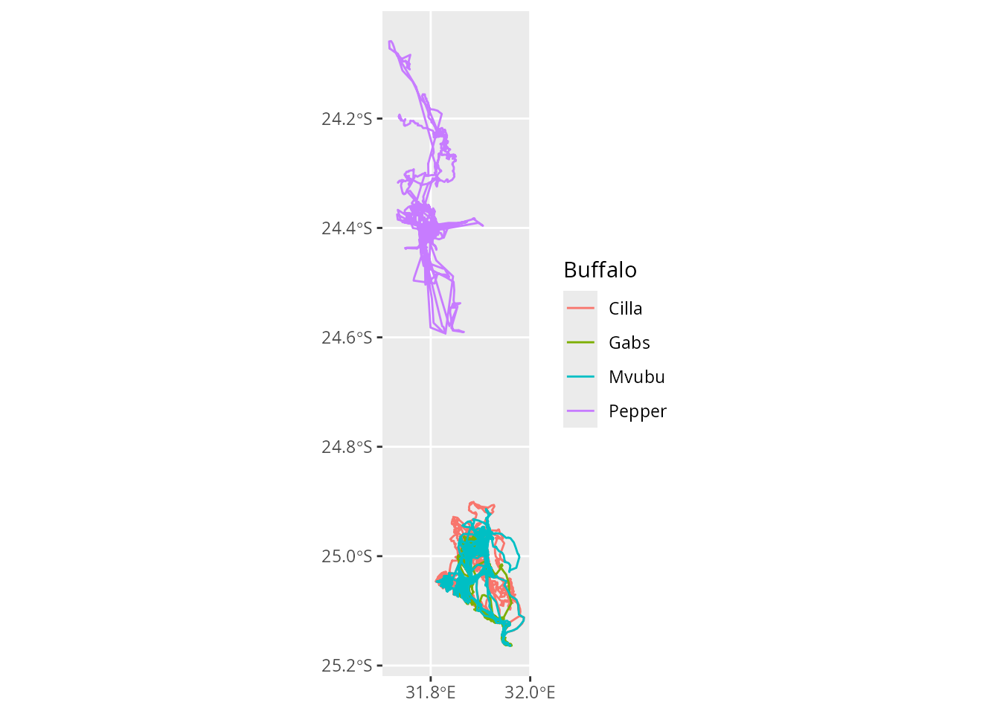
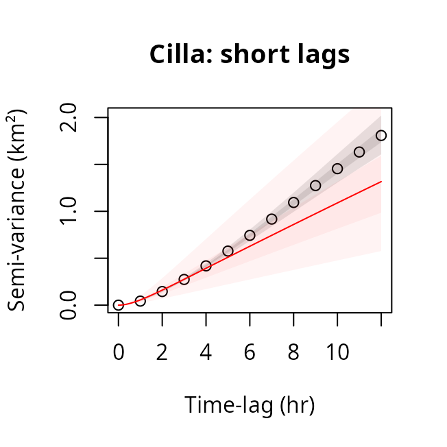
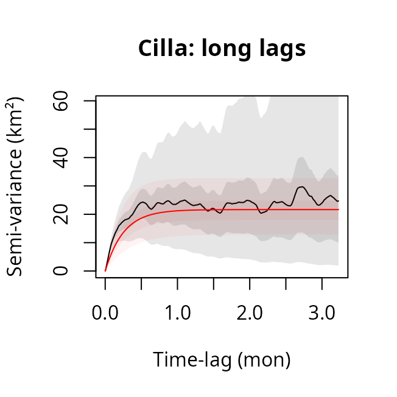
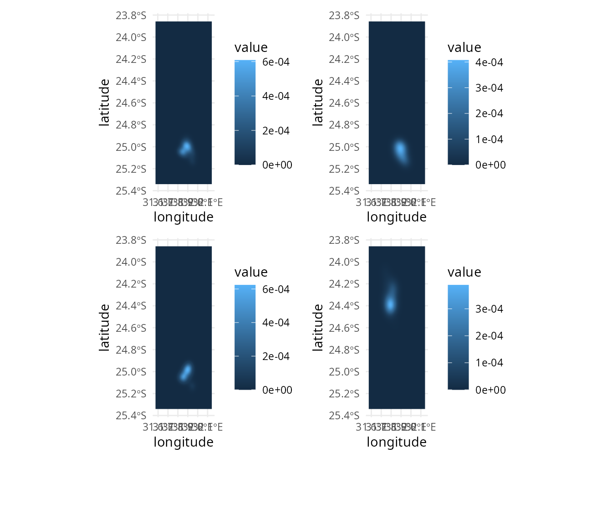
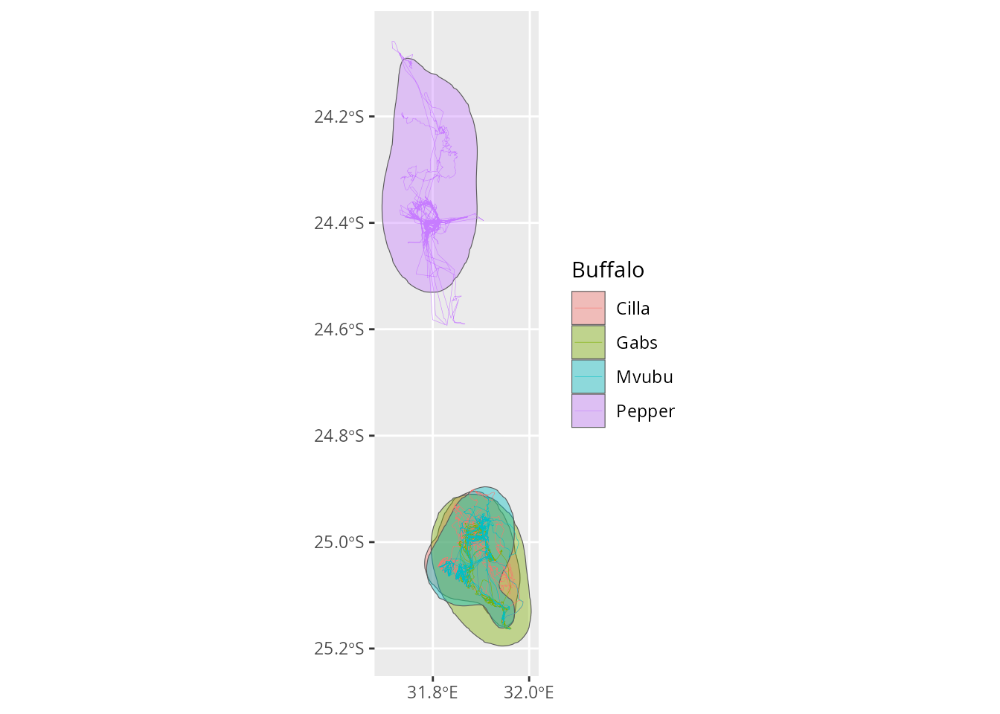
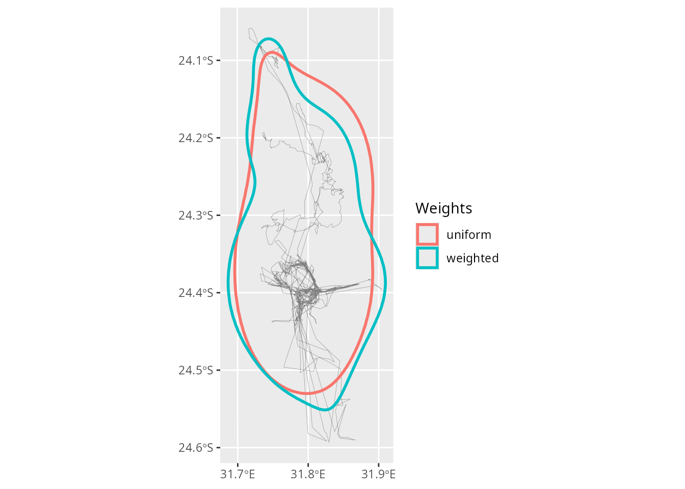
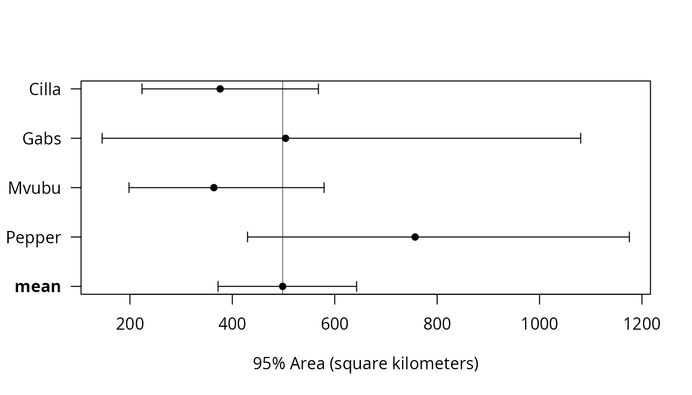
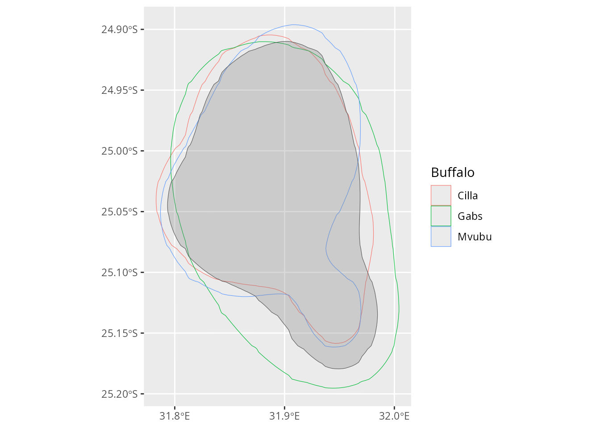

<!--
ctmm_models.Rmd is precompiled from ctmm_models.Rmd.orig, as fitting the
models takes too long to run when building the website: edit
ctmm_models.Rmd.orig, then run code/precompile_ctmm_models.R to update
ctmm_models.Rmd and its figures.
-->


The package [`ctmm`](https://ctmm-initiative.github.io/ctmm/) implements
continuous-time movement models, which describe how the locations of an
animal are correlated in time. Tracking data are strongly autocorrelated
(consecutive locations are close to each other), and methods that assume
independent locations, such as conventional kernel density estimation
(KDE), underestimate home ranges and their uncertainty. Continuous-time
movement models account for this autocorrelation, and are the basis of
methods such as autocorrelated kernel density estimation (AKDE, Fleming et al.
2015).

`tidytracks` provides an interface to `ctmm` that follows a simple, modular
workflow:

1. prepare a tibble of tracks in a projected coordinate reference system;
2. fit a movement model to each track with `ctmm_tt_fit()`, which returns a
   table of models with one row per track, in the same order as the metadata;
3. inspect and summarise the models (`ctmm_tt_summary()`);
4. use the models, together with the tracks, for further analyses, such as
   estimating home ranges with `hr_tt_akde()`.

In this article, we follow the examples of the `ctmm` vignettes, using the
same data, to show how this workflow fits with the rest of `tidytracks`.


``` r
library(tidytracks)
library(ctmm)
library(ggplot2)
library(dplyr)
```

## The data

We use the GPS tracks of African buffalo (*Syncerus caffer*) from Kruger
National Park, South Africa (Getz et al. 2007, Cross et al. 2016), which are
also used in the `ctmm` vignettes (`ctmm` provides them as a list of
`telemetry` objects, which can be converted to a tibble of tracks with
`mt_as_move2()`). Fitting movement models to long tracks takes a few minutes
per track, so, to keep this article quick to run, we use four of the six
buffalo of the dataset: Cilla, Gabs and Mvubu, which share an area in the
south of the park, and Pepper, whose GPS collar changed its sampling schedule
(see below).

The tracks are stored in a CSV file, with one row per location: the id of
the buffalo (`buffalo_id`), the time in UTC (`date_time`), and the longitude
and latitude (`lon` and `lat`). The file also includes the sex and the age
class of each buffalo (`sex` and `age`; they are all adult females). As these
values are repeated for all the locations of a buffalo, `tt_read_data()`
moves them to the metadata of the tibble of tracks:


``` r
buffalo_tt <- tt_read_data(
  events = "data/buffalo_tracks.csv",
  col_track_id = "buffalo_id",
  col_coords = c("lon", "lat"),
  col_date_time = "date_time"
)
buffalo_tt
#> A <move2> with `track_id_column` "buffalo_id" and `time_column` "date_time"
#> Containing 4 tracks lasting on average 147 days in a
#> Simple feature collection with 9820 features and 2 fields
#> Geometry type: POINT
#> Dimension:     XY
#> Bounding box:  xmin: 31.71643 ymin: -25.16421 xmax: 31.98769 ymax: -24.05847
#> Geodetic CRS:  WGS 84
#> First 10 features:
#>    buffalo_id           date_time                   geometry
#> 1       Cilla 2005-07-14 05:35:00 POINT (31.88776 -24.96738)
#> 2       Cilla 2005-07-14 07:35:00 POINT (31.85942 -24.94288)
#> 3       Cilla 2005-07-14 08:34:00 POINT (31.85512 -24.94914)
#> 4       Cilla 2005-07-14 09:35:00 POINT (31.85694 -24.95424)
#> 5       Cilla 2005-07-14 10:35:00 POINT (31.85977 -24.94735)
#> 6       Cilla 2005-07-14 11:34:00 POINT (31.84466 -24.93435)
#> 7       Cilla 2005-07-14 12:35:00    POINT (31.8441 -24.934)
#> 8       Cilla 2005-07-14 13:34:00 POINT (31.84463 -24.93442)
#> 9       Cilla 2005-07-14 14:35:00   POINT (31.857 -24.93371)
#> 10      Cilla 2005-07-14 15:35:00 POINT (31.86478 -24.93985)
#> Track features:
#>   buffalo_id    sex   age
#> 1      Cilla female adult
#> 2       Gabs female adult
#> 3      Mvubu female adult
#> 4     Pepper female adult
```


``` r
show_meta(buffalo_tt)
#>   buffalo_id    sex   age
#> 1      Cilla female adult
#> 2       Gabs female adult
#> 3      Mvubu female adult
#> 4     Pepper female adult
```


``` r
ggplot() +
  geom_track_path(data = buffalo_tt, mapping = aes(colour = buffalo_id)) +
  scale_x_continuous(breaks = seq(31.6, 32, by = 0.2)) +
  labs(colour = "Buffalo")
```



## Projecting the data

`ctmm` works with coordinates in a projected CRS, with units in metres. If we
try to use data in longitude and latitude, we get an error:


``` r
buffalo_fit <- ctmm_tt_fit(buffalo_tt)
#> Error:
#> ! ctmm requires x to be in a projected coordinate reference system (not longitude/latitude); project x with `sf::st_transform()`, e.g. using the projection suggested by `crstools::suggest_crs(x)` for the area covered by the tracks
```

The package [`crstools`](https://evolecolgroup.github.io/crstools/) can
suggest an appropriate projection for the area covered by the tracks. For
home ranges, where we are interested in areas, an equal-area projection is a
good choice (the default of `crstools::suggest_crs()`):


``` r
library(crstools)
buffalo_crs <- suggest_crs(buffalo_tt, quiet = TRUE)
buffalo_crs$description
#> [1] "Transverse cylindrical equal-area"
buffalo_tt <- sf::st_transform(buffalo_tt, buffalo_crs$wkt)
```

## Fitting movement models

`ctmm_tt_fit()` fits a continuous-time movement model to each track. By
default (`model = "auto"`), it selects the best model for each track based on
AICc (with `ctmm::ctmm.select()`): starting from the model suggested by the
variogram of the track, generally a model with autocorrelated positions and
velocities (Ornstein-Uhlenbeck foraging, OUF), it fits simpler models, such
as models with autocorrelated positions only (Ornstein-Uhlenbeck, OU), with
independent locations (IID), or with isotropic movement, until AICc no longer
improves. Fitting can take a while for long tracks; `ctmm` prints the minimum
sampling interval of each track as it reads it.


``` r
buffalo_fit <- ctmm_tt_fit(buffalo_tt)
#> Minimum sampling interval of 3 minutes in Cilla
#> Minimum sampling interval of 2 minutes in Gabs
#> Minimum sampling interval of 2 minutes in Mvubu
#> Minimum sampling interval of 3 minutes in Pepper
buffalo_fit
#> # A tibble: 4 × 9
#>   buffalo_id model        model_name         aicc dof_area n_events
#>   <fct>      <named list> <chr>             <dbl>    <dbl>    <int>
#> 1 Cilla      <ctmm>       OUF anisotropic 100360.    18.1      3527
#> 2 Gabs       <ctmm>       OUF anisotropic  55552.     4.30     1996
#> 3 Mvubu      <ctmm>       OUF anisotropic  73064.    13.8      2572
#> 4 Pepper     <ctmm>       OUF anisotropic  53671.    15.7      1725
#> # ℹ 3 more variables: t_start <dttm>, t_end <dttm>, fit_message <chr>
```

The result is a table with one row per track, in the same order as the
metadata of the tibble of tracks (see `show_meta()`). Besides the fitted
models (column `model`), the table includes the name of the selected model,
its AICc, and the effective sample size for the home range area (`dof_area`),
which is much smaller than the number of locations because of
autocorrelation: tracks with few home range crossings provide little
information on the home range, and lead to uncertain estimates.

The table has the same id column as the metadata (`buffalo_id`), so it can
be joined with the metadata, for example to compare the models of
individuals of different sex or age (here, all the buffalo are adult
females):


``` r
show_meta(buffalo_tt) %>%
  left_join(
    select(buffalo_fit, buffalo_id, model_name, dof_area),
    by = "buffalo_id"
  )
#>   buffalo_id    sex   age      model_name  dof_area
#> 1      Cilla female adult OUF anisotropic 18.135827
#> 2       Gabs female adult OUF anisotropic  4.295612
#> 3      Mvubu female adult OUF anisotropic 13.848033
#> 4     Pepper female adult OUF anisotropic 15.657504
```

With `candidates = TRUE`, `ctmm_tt_fit()` also returns all the candidate
models of each track, which is useful to inspect the model selection. Instead
of selecting a model, we can also fit a given model to all tracks (e.g.
`model = "ouf"`), or provide model templates created with `ctmm::ctmm()`.

## Checking the fit of the models

The models are standard `ctmm` objects, so we can use all the functions of
`ctmm` to inspect them. A good way to check the fit of a model is to compare
it with the empirical variogram of the track, which shows the average
square distance between locations as a function of the time lag between them
(see the `ctmm` vignette on variograms). To use `ctmm` functions on the data,
we convert the tibble of tracks to a list of `telemetry` objects with
`mt_as_telemetry()`:


``` r
buffalo_tel <- mt_as_telemetry(buffalo_tt)
names(buffalo_tel)
#> [1] "Cilla"  "Gabs"   "Mvubu"  "Pepper"
```

We can now compute the empirical variogram of Cilla, the first buffalo, and
extract its fitted model:


``` r
cilla_svf <- variogram(buffalo_tel$Cilla)
cilla_model <- buffalo_fit$model$Cilla
```

and plot them together, both at short time lags (where we see the
autocorrelation of the velocity) and at long time lags (where the variogram
levels off at the size of the home range):


``` r
plot(
  cilla_svf,
  CTMM = cilla_model,
  xlim = c(0, 12 %#% "hour"),
  level = c(0.5, 0.95)
)
title("Cilla: short lags")
plot(cilla_svf, CTMM = cilla_model, fraction = 0.65, level = c(0.5, 0.95))
title("Cilla: long lags")
```



## Summarising the models

`ctmm_tt_summary()` extracts the parameters of the models, with their
confidence intervals, as a table with one row per track. The parameters
include the area of the home range of the model (`area`), the home range
crossing time (`tau_position`), the time scale of the autocorrelation of the
velocity (`tau_velocity`), and the root-mean-square speed (`speed`), which is
a convenient measure of how fast the animal moves, but not its mean speed
(see [Going further](#going-further)):


``` r
buffalo_summary <- ctmm_tt_summary(buffalo_fit)
names(buffalo_summary)
#>  [1] "buffalo_id"        "model_name"        "dof_area"         
#>  [4] "area_low"          "area_est"          "area_high"        
#>  [7] "tau_position_low"  "tau_position_est"  "tau_position_high"
#> [10] "tau_velocity_low"  "tau_velocity_est"  "tau_velocity_high"
#> [13] "speed_low"         "speed_est"         "speed_high"       
#> [16] "diffusion_low"     "diffusion_est"     "diffusion_high"
```

Each parameter has three columns: the lower bound of its confidence interval
(`_low`), its estimate (`_est`) and the upper bound (`_high`). Printing such a
wide table is not very useful, as the columns that do not fit in the console
are hidden. 

To look at the parameters we are interested in, we can use
`transmute()` from `dplyr`, which keeps only the columns that we list, and
can modify them at the same time (it combines `select()` and `mutate()`).

Modifying the columns is useful here, as the values are `units` objects in SI
units: areas are in square metres, time scales in seconds, and speeds in
metres per second. For buffalo, which live in home ranges of hundreds of
square kilometres and take days to cross them, these numbers are very large
or very small, and hard to interpret. With `units::set_units()`, we can
convert each column to a more intuitive unit, which is shown under the name
of the column:


``` r
buffalo_summary %>%
  transmute(
    buffalo_id,
    model_name,
    area_est = units::set_units(area_est, "km^2"),
    tau_position_est = units::set_units(tau_position_est, "days"),
    speed_est = units::set_units(speed_est, "km/day")
  )
#> # A tibble: 4 × 5
#>   buffalo_id model_name      area_est tau_position_est speed_est
#>   <fct>      <chr>             [km^2]              [d]    [km/d]
#> 1 Cilla      OUF anisotropic     403.             7.51      14.1
#> 2 Gabs       OUF anisotropic     529.            18.2       13.7
#> 3 Mvubu      OUF anisotropic     405.             6.75      14.4
#> 4 Pepper     OUF anisotropic     774.            13.4       16.5
```

We did not save the result of `transmute()`, as it is only used to display
the table: `buffalo_summary` still has all its columns, in SI units. We use
the same approach to display the other tables in this article.

## Autocorrelated kernel density estimation

The fitted models can be used to estimate home ranges with AKDE, which
accounts for the autocorrelation of locations. `hr_tt_akde()` requires both
the tibble of tracks and the table of models:


``` r
buffalo_akde <- hr_tt_akde(buffalo_tt, buffalo_fit)
#> Default grid size of 3 minutes chosen for bandwidth(...,fast=TRUE).
#> Default grid size of 2 minutes chosen for bandwidth(...,fast=TRUE).
#> Default grid size of 2 minutes chosen for bandwidth(...,fast=TRUE).
#> Default grid size of 3 minutes chosen for bandwidth(...,fast=TRUE).
buffalo_akde
#> # A tibble: 4 × 11
#>   buffalo_id method model_name     dof_area    xmin    ymin   xmax    ymax   res
#>   <chr>      <chr>  <chr>             <dbl>   <dbl>   <dbl>  <dbl>   <dbl> <dbl>
#> 1 Cilla      akde   OUF anisotrop…    18.1  -27948. -2.82e6 29196. -2.66e6  279.
#> 2 Gabs       akde   OUF anisotrop…     4.30 -27948. -2.82e6 29196. -2.66e6  279.
#> 3 Mvubu      akde   OUF anisotrop…    13.8  -27948. -2.82e6 29196. -2.66e6  279.
#> 4 Pepper     akde   OUF anisotrop…    15.7  -27948. -2.82e6 29196. -2.66e6  279.
#> # ℹ 2 more variables: ud <named list>, ud_ctmm <named list>
```

The result is a table of utilisation distributions (UDs) of class
`hr_tt_ud_tbl`, as returned by `hr_tt_kde()`, which can be used with the
other `hr_tt_` functions. The UDs are estimated on a grid shared by all
tracks; by default, its resolution follows the default of `ctmm`, and its
extent contains all the UDs. The table also includes the UDs as `ctmm`
objects (column `ud_ctmm`), which can be used with the functions of `ctmm`.


``` r
autoplot(buffalo_akde)
```



The isopleths (i.e. the home ranges at given levels) can be obtained from the
UDs with `hr_tt_ud_iso()`, as for the other methods to estimate home ranges.
For AKDE, the table of isopleths also includes the confidence intervals of
the area of each home range (`area_low` and `area_high`), which `ctmm`
estimates from the `ctmm` UDs:


``` r
buffalo_iso <- hr_tt_ud_iso(buffalo_akde, levels = c(0.5, 0.95))
```

The same isopleths can be obtained directly by setting `levels` in
`hr_tt_akde()`, which is convenient if we do not need the UDs (we do so
below). To display the areas, we use `transmute()` as above. The table of
isopleths is an `sf` object, whose geometry column is always kept by
`transmute()`, so we first drop it with `sf::st_drop_geometry()`:


``` r
buffalo_iso %>%
  sf::st_drop_geometry() %>%
  transmute(
    buffalo_id,
    level,
    area = units::set_units(area, "km^2"),
    area_low = units::set_units(area_low, "km^2"),
    area_high = units::set_units(area_high, "km^2")
  )
#> # A tibble: 8 × 5
#>   buffalo_id level   area area_low area_high
#>   <chr>      <dbl> [km^2]   [km^2]    [km^2]
#> 1 Cilla       0.5    89.3     52.9      135.
#> 2 Cilla       0.95  375.     223.       568.
#> 3 Gabs        0.5   129.      37.6      279.
#> 4 Gabs        0.95  502.     146.      1080.
#> 5 Mvubu       0.5    83.1     45.1      132.
#> 6 Mvubu       0.95  365.     198.       579.
#> 7 Pepper      0.5   158.      90.2      247.
#> 8 Pepper      0.95  756.     430.      1176.
```


``` r
ggplot() +
  geom_sf(
    data = filter(buffalo_iso, level == 0.95),
    mapping = aes(fill = buffalo_id),
    alpha = 0.4
  ) +
  geom_track_path(
    data = buffalo_tt,
    mapping = aes(colour = buffalo_id),
    linewidth = 0.1
  ) +
  scale_x_continuous(breaks = seq(31.6, 32, by = 0.2)) +
  labs(fill = "Buffalo", colour = "Buffalo")
```



### AKDE versus KDE

To see the effect of accounting for autocorrelation, we can compare the AKDE
home ranges with those estimated with conventional KDE (`hr_tt_kde()`), using
the reference bandwidth for each buffalo. So that the two estimates are
comparable, we estimate the KDE on the same grid as the AKDE, using the
bounding box and resolution of the grid stored in the table of AKDE UDs (the
grid is the same for all buffalo, so we take it from the first row):


``` r
buffalo_kde_iso <- hr_tt_kde(
  buffalo_tt,
  h = "h_ref_indiv",
  bbox = unlist(buffalo_akde[1, c("xmin", "ymin", "xmax", "ymax")]),
  res = buffalo_akde$res[1],
  levels = 0.95
)
```

To compare the two estimates, we first stack the 95% home ranges of the two
methods in a single table with `bind_rows()`, which appends the rows of the
second table to those of the first. Both tables have a column `method`
(`"akde"` or `"kde"`), so we can still tell which method each row comes
from. Columns that are only present in one of the tables (e.g. the
confidence intervals `area_low` and `area_high`, which KDE does not provide)
are filled with `NA` for the rows of the other table:


``` r
buffalo_hr_95 <- bind_rows(
  filter(buffalo_iso, level == 0.95),
  buffalo_kde_iso
)
```

We then reshape the table with `tidyr::pivot_wider()`, so that each buffalo
is a row and each method a column. `pivot_wider()` uses all the columns that
are not reshaped to identify the rows, and these differ between the two
methods (e.g. `h`, the bandwidth, is only defined for KDE), so we first use
`transmute()` to keep only the id of the buffalo, the method and the area:


``` r
buffalo_hr_95 %>%
  sf::st_drop_geometry() %>%
  transmute(buffalo_id, method, area = units::set_units(area, "km^2")) %>%
  tidyr::pivot_wider(names_from = method, values_from = area)
#> # A tibble: 4 × 3
#>   buffalo_id   akde    kde
#>   <chr>      [km^2] [km^2]
#> 1 Cilla        375.   294.
#> 2 Gabs         502.   212.
#> 3 Mvubu        365.   243.
#> 4 Pepper       756.   614.
```

Conventional KDE, which ignores the autocorrelation of the locations, gives
smaller home ranges for all buffalo, and no measure of the uncertainty of the
estimates. The difference is largest for Gabs, whose track has the fewest
independent observations of the home range (the lowest `dof_area`, see
above).

### Irregular sampling

The tracks of some buffalo are sampled irregularly: Pepper, for example, was
sampled every hour at the start of the deployment, and every two hours
afterwards, because of a malfunction of the GPS collar. With
`weights = TRUE`, `hr_tt_akde()` weights the locations to correct for the
over-representation of the periods sampled more frequently (Fleming et al.
2018). This is slower, so here we only use it for Pepper:


``` r
pepper_tt <- filter_by_meta(buffalo_tt, buffalo_id == "Pepper")
pepper_iso <- bind_rows(
  uniform = hr_tt_akde(pepper_tt, buffalo_fit, levels = 0.95),
  weighted = hr_tt_akde(pepper_tt, buffalo_fit, levels = 0.95, weights = TRUE),
  .id = "weights"
)
#> Default grid size of 3 minutes chosen for bandwidth(...,fast=TRUE).
#> Default grid size of 3 minutes chosen for bandwidth(...,fast=TRUE).
```

Here, the two tables have the same columns, so we name them in `bind_rows()`
(`uniform` and `weighted`), and use `.id` to add a column `weights` with the
name of the table each row comes from. We can then compare the areas:


``` r
pepper_iso %>%
  sf::st_drop_geometry() %>%
  transmute(
    weights,
    area = units::set_units(area, "km^2"),
    area_low = units::set_units(area_low, "km^2"),
    area_high = units::set_units(area_high, "km^2")
  )
#> # A tibble: 2 × 4
#>   weights    area area_low area_high
#>   <chr>    [km^2]   [km^2]    [km^2]
#> 1 uniform    756.     430.     1175.
#> 2 weighted   760.     432.     1182.
```

Note that the table of models includes all buffalo: `hr_tt_akde()` matches
the models to the tracks by their id. Here, weighting changes the estimated
area only slightly, but it changes the shape of the home range, as we can see
by plotting the two isopleths over the track of Pepper:


``` r
ggplot() +
  geom_track_path(data = pepper_tt, colour = "grey50", linewidth = 0.1) +
  geom_sf(
    data = pepper_iso,
    mapping = aes(colour = weights),
    fill = NA,
    linewidth = 1
  ) +
  scale_x_continuous(breaks = seq(31.6, 32, by = 0.1)) +
  labs(colour = "Weights")
```



## Comparing home ranges

As the UDs of all buffalo are on the same grid, we can compute their overlap
with `hr_tt_ud_overlap()`. With `method = "ba"`, the overlap is measured by
the Bhattacharyya coefficient, which is 1 for identical UDs and 0 for UDs
that share no area:


``` r
buffalo_ba <- hr_tt_ud_overlap(buffalo_akde, method = "ba")
buffalo_ba
#>            Cilla      Gabs     Mvubu Pepper
#> Cilla  1.0000000 0.9424306 0.9776695      0
#> Gabs   0.9424306 1.0000000 0.9125376      0
#> Mvubu  0.9776695 0.9125376 1.0000000      0
#> Pepper 0.0000000 0.0000000 0.0000000      1
```

Alternatively, we can use `ctmm::overlap()` on the `ctmm` UDs, which also
estimates the Bhattacharyya coefficient, with confidence intervals:


``` r
buffalo_overlap <- ctmm::overlap(buffalo_akde$ud_ctmm)
```

The element `CI` of the result is an array with the lower bound, the estimate
and the upper bound of the overlap of each pair of buffalo. For Cilla and
Gabs, we get:


``` r
buffalo_overlap$CI["Cilla", "Gabs", ]
#>       low       est      high 
#> 0.8958166 0.9958137 1.0000000
```

The estimate of `ctmm`
(0.996) is higher than
the overlap computed by `hr_tt_ud_overlap()`
(0.942), because `ctmm` corrects it for
a bias (Winner et al. 2018). Each UD is estimated from few independent
observations of the home range (`dof_area` is only
4.3 for
Gabs), so even two buffalo using exactly the same area would have estimated
UDs that differ by chance: the overlap of the estimated UDs, as computed by
`hr_tt_ud_overlap()`, underestimates the overlap of the true UDs. `ctmm` uses
the movement models to estimate how large this bias is, and removes it (with
`debias = FALSE`, it gives the same estimate as `hr_tt_ud_overlap()`). Here,
nearly all the difference between the UDs of Cilla and Gabs could be due to
chance, so the corrected estimate is close to 1. This does not mean that the
two buffalo use exactly the same area, but that we cannot tell their home
ranges apart with these data: the confidence interval shows that their
overlap is at least
0.896.

The `ctmm` UDs can also be used for population-level analyses, such as
estimating the mean home range area of the buffalo with `ctmm::meta()`:


``` r
ctmm::meta(buffalo_akde$ud_ctmm)
#>                     ΔAICc
#> Dirac-δ          0.000000
#> inverse-Gaussian 9.323209
```



```
#>                 low      est     high
#> mean (km²) 372.0995 498.3215 642.6934
#> CoV²         0.0000   0.0000      Inf
#> CoV          0.0000   0.0000      Inf
```

## Population home ranges

The home ranges of several individuals can be combined into a population home
range with `hr_tt_akde_pop()`. By default, it uses population kernel density
estimation (`ctmm::pkde()`), which estimates the population UD from the
locations of all the individuals, using the movement model of each of them;
it therefore needs the tibble of tracks and the table of models, as well as
the UDs. The uncertainty of the population home range area accounts for the
variation among individuals, so it can be large when combining few
individuals.

Population kernel density estimation assumes that the individuals are a
sample from a single population, sharing an area. Cilla, Gabs and Mvubu live
in the same area in the south of the park, whereas Pepper lives further north,
so we combine the home ranges of the three southern buffalo. Combining at
least three individuals is also safer: with only two, the parameters of the
population are poorly determined, and their estimation can fail. `ctmm`
estimates some of these parameters (e.g. the bandwidth of the population
kernels) with a stochastic optimiser, so the results can differ between runs;
to make them reproducible, we set the seed of the random number generator
first:


``` r
south_ids <- c("Cilla", "Gabs", "Mvubu")
south_akde <- filter(buffalo_akde, buffalo_id %in% south_ids)
set.seed(1)
south_pop <- hr_tt_akde_pop(
  south_akde,
  tracks = buffalo_tt,
  models = buffalo_fit,
  levels = 0.95
)
```

As for the individual home ranges, we display the area of the population home
range, with its confidence interval:


``` r
south_pop %>%
  sf::st_drop_geometry() %>%
  transmute(
    method,
    n_ud,
    area = units::set_units(area, "km^2"),
    area_low = units::set_units(area_low, "km^2"),
    area_high = units::set_units(area_high, "km^2")
  )
#> # A tibble: 1 × 5
#>   method  n_ud   area area_low area_high
#>   <chr>  <int> [km^2]   [km^2]    [km^2]
#> 1 pkde       3   377.     261.      516.
```


``` r
ggplot() +
  geom_sf(
    data = filter(buffalo_iso, level == 0.95, buffalo_id %in% south_ids),
    mapping = aes(colour = buffalo_id),
    fill = NA
  ) +
  geom_sf(data = south_pop, fill = "grey50", alpha = 0.3) +
  scale_x_continuous(breaks = seq(31.8, 32, by = 0.1)) +
  labs(colour = "Buffalo")
```



Alternatively, with `method = "mean"`, the population UD is the average of
the individual UDs (as with `hr_tt_ud_sum()`), with confidence intervals of
the population home range area. If the table of UDs is grouped (e.g. after
joining a variable from the metadata, such as sex, and grouping by it), a
population home range is estimated for each group.

## Going further

The fitted models can be used with any other function of `ctmm`, by
combining them with the `telemetry` objects created with `mt_as_telemetry()`.
For example, we can estimate the mean speed of Cilla, with its confidence
interval:


``` r
cilla_speed <- ctmm::speed(
  buffalo_fit$model$Cilla,
  buffalo_tel$Cilla,
  trace = FALSE
)
cilla_speed
#> $DOF
#>    speed 
#> 2981.384 
#> 
#> $CI
#>                             low      est     high
#> speed (kilometers/day) 10.94474 11.14431 11.34477
#> 
#> attr(,"class")
#> [1] "speed"
```

The mean speed of Cilla
(11.1 km/day) is lower than the speed in
the summary of its model
(14.1
km/day, see above), which is the root-mean-square speed: the square root of
the mean of the squared speeds, which gives more weight to fast movements.

We can also simulate a track from the model of Cilla, conditional on the observed
locations (e.g. to fill gaps), and convert it back to a tibble of tracks with
`mt_as_move2()`:


``` r
# times every 20 minutes during the first two days of the track
cilla_times <- seq(
  from = min(buffalo_tel$Cilla$t),
  to = min(buffalo_tel$Cilla$t) + 2 %#% "day",
  by = 20 %#% "minute"
)
cilla_sim <- simulate(
  buffalo_fit$model$Cilla,
  data = buffalo_tel$Cilla,
  t = cilla_times
)
# simulated tracks only have the time in seconds, so we add the timestamp
cilla_sim$timestamp <- as.POSIXct(
  cilla_sim$t,
  origin = "1970-01-01",
  tz = "UTC"
)
cilla_sim_tt <- mt_as_move2(cilla_sim)
cilla_sim_tt
#> A <move2> with `track_id_column` "track" and `time_column` "timestamp"
#> Containing 1 track lasting 2 days in a
#> Simple feature collection with 145 features and 5 fields
#> Geometry type: POINT
#> Dimension:     XY
#> Bounding box:  xmin: -936.9335 ymin: -2786669 xmax: 5237.818 ymax: -2775608
#> Projected CRS: +proj=tcea +lat_0=0 +lon_0=31.85206 +k=1 +x_0=0 +y_0=0 +datum=WGS84 +units=m +no_defs
#> First 10 features:
#>             t          vx          vy           timestamp track
#> 1  1121319300 -0.36474526  0.25035435 2005-07-14 05:35:00 Cilla
#> 2  1121320500 -0.46580231  0.33960335 2005-07-14 05:55:00 Cilla
#> 3  1121321700 -0.46393348  0.48346181 2005-07-14 06:15:00 Cilla
#> 4  1121322900 -0.47061297  0.45258977 2005-07-14 06:35:00 Cilla
#> 5  1121324100 -0.39054837  0.49700560 2005-07-14 06:55:00 Cilla
#> 6  1121325300 -0.30207342  0.43040878 2005-07-14 07:15:00 Cilla
#> 7  1121326500 -0.23359625  0.05251543 2005-07-14 07:35:00 Cilla
#> 8  1121327700 -0.13995180 -0.19347276 2005-07-14 07:55:00 Cilla
#> 9  1121328900 -0.10462817 -0.29340779 2005-07-14 08:15:00 Cilla
#> 10 1121330100  0.03079108 -0.38949077 2005-07-14 08:35:00 Cilla
#>                     geometry
#> 1  POINT (3602.718 -2779357)
#> 2  POINT (3166.812 -2779050)
#> 3  POINT (2567.824 -2778569)
#> 4  POINT (1995.777 -2778030)
#> 5  POINT (1461.625 -2777459)
#> 6   POINT (1036.69 -2776871)
#> 7  POINT (742.8932 -2776629)
#> 8  POINT (503.6058 -2776650)
#> 9  POINT (337.3364 -2776958)
#> 10 POINT (311.2659 -2777348)
#> Track features:
#>   track
#> 1 Cilla
```

## References

Cross, P.C., Bowers, J.A., Hay, C.T., Wolhuter, J., Buss, P., Hofmeyr, M., du
Toit, J.T. & Getz, W.M. (2016) Data from: Nonparameteric kernel methods for
constructing home ranges and utilization distributions. Movebank Data
Repository. DOI: 10.5441/001/1.j900f88t

Fleming, C.H., Fagan, W.F., Mueller, T., Olson, K.A., Leimgruber, P. &
Calabrese, J.M. (2015) Rigorous home range estimation with movement data: a
new autocorrelated kernel density estimator. Ecology, 96, 1182-1188.

Fleming, C.H., Sheldon, D., Fagan, W.F., Leimgruber, P., Mueller, T.,
Nandintsetseg, D., Noonan, M.J., Olson, K.A., Setyawan, E., Sianipar, A. &
Calabrese, J.M. (2018) Correcting for missing and irregular data in
home-range estimation. Ecological Applications, 28, 1003-1010.

Getz, W.M., Fortmann-Roe, S., Cross, P.C., Lyons, A.J., Ryan, S.J. & Wilmers,
C.C. (2007) LoCoH: nonparameteric kernel methods for constructing home ranges
and utilization distributions. PLoS ONE, 2, e207.

Winner, K., Noonan, M.J., Fleming, C.H., Olson, K.A., Mueller, T., Sheldon, D.
& Calabrese, J.M. (2018) Statistical inference for home range overlap.
Methods in Ecology and Evolution, 9, 1679-1691.
